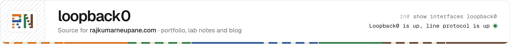
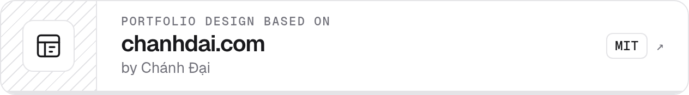
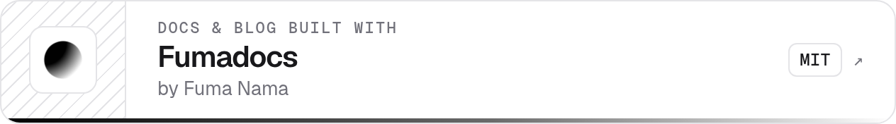

  <picture>
    <source media="(prefers-color-scheme: dark)" srcset=".github/assets/banner-slim-dark.png">
    
  </picture>

Source for **[rajkumarneupane.com](https://rajkumarneupane.com)**: the portfolio, lab notes, and blog of Rajkumar Neupane, a CCNA and CCST certified network support technician in Toronto.

Spotted a mistake on a page? Use the **Report an issue** link at the bottom of it.

## Credits

  <a href="https://github.com/ncdai/chanhdai.com"><picture><source media="(prefers-color-scheme: dark)" srcset=".github/assets/credit-chanhdai-v2-dark.png"></picture></a>
  <a href="https://github.com/fuma-nama/fumadocs"><picture><source media="(prefers-color-scheme: dark)" srcset=".github/assets/credit-fumadocs-dark.png"></picture></a>

## License

The code is MIT licensed (see [`LICENSE`](LICENSE)). The writing in `content/` and the photos in `public/` are © Rajkumar Neupane, all rights reserved.

[LinkedIn](https://www.linkedin.com/in/rjneupane) · [Credly](https://www.credly.com/users/rajkumarneupane)
