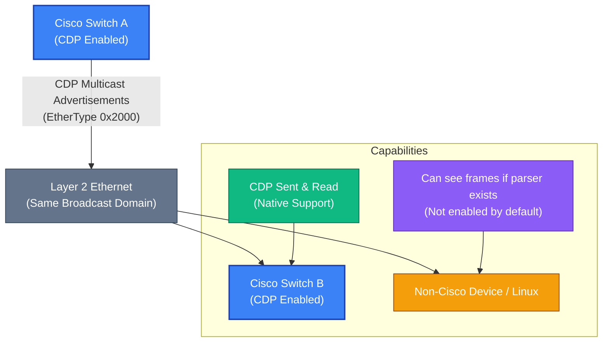

## Overview

The Cisco Discovery Protocol (CDP) advertises information about directly connected devices in Cisco networks. It shares details such as platform type, software version, and IP addressing. Although industry documentation describes CDP as a Cisco-only protocol, this restriction primarily stems from vendor implementation and operational practices rather than protocol design.

Non-Cisco devices or Linux systems capable of decoding Ethernet frames can potentially read CDP advertisements. They can also transmit CDP frames that Cisco devices accept. This functionality presents a potential Layer 2 security concern due to the detailed network information CDP exposes. Technical barriers to non-Cisco participation are minimal. The primary limitations are a lack of native support and Cisco-specific enforcement mechanisms.

This post examines CDP from a protocol and security perspective. It analyzes whether the security of CDP relies on technical controls, vendor boundaries, or best-practice configurations such as disabling CDP on untrusted interfaces.

### Scenario

