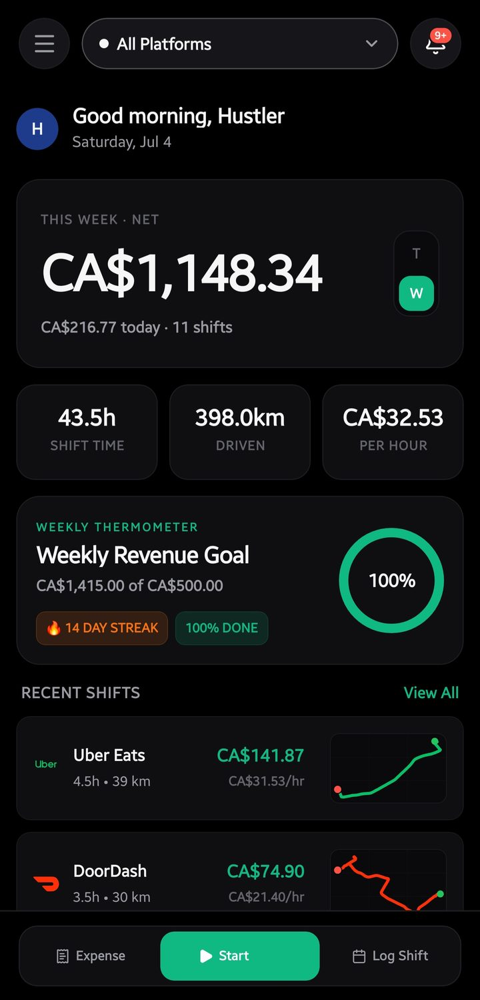
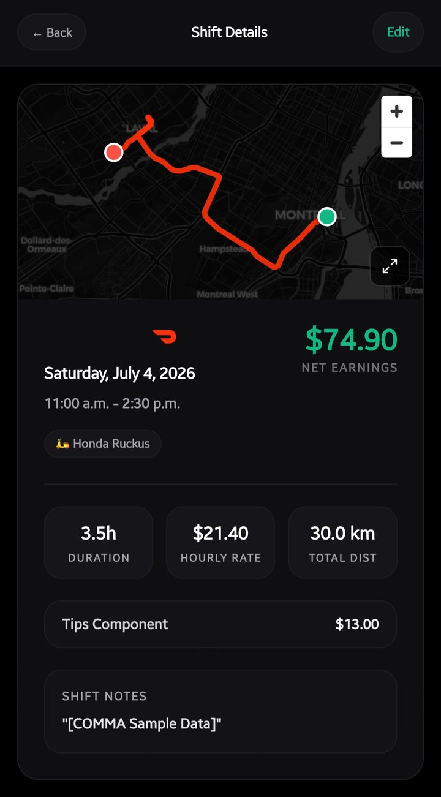
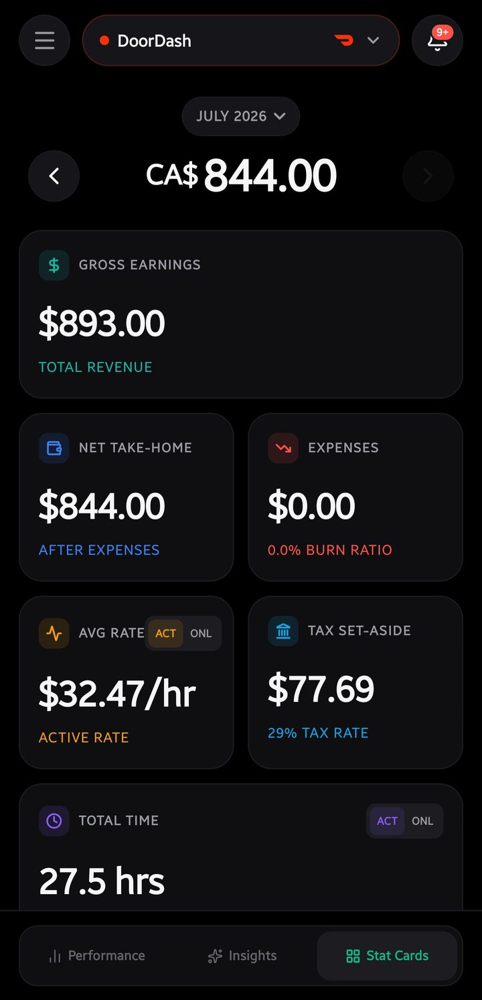
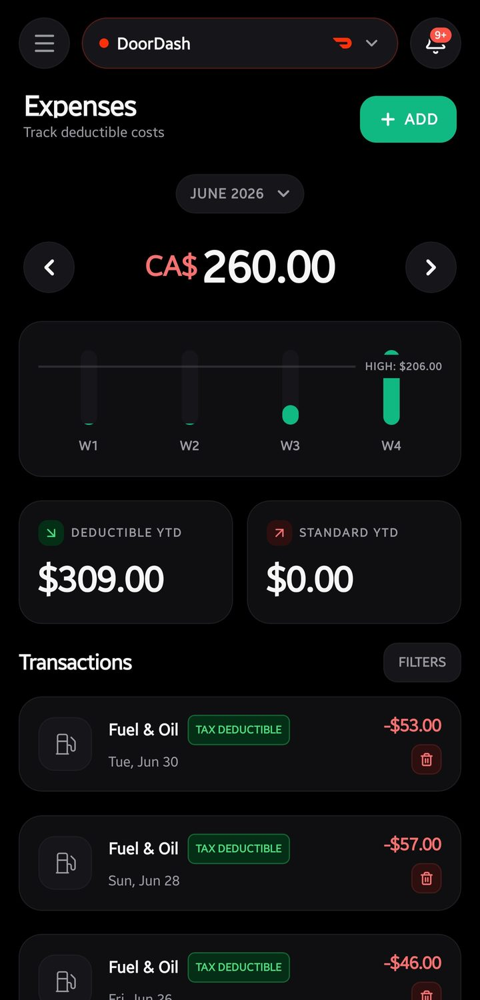
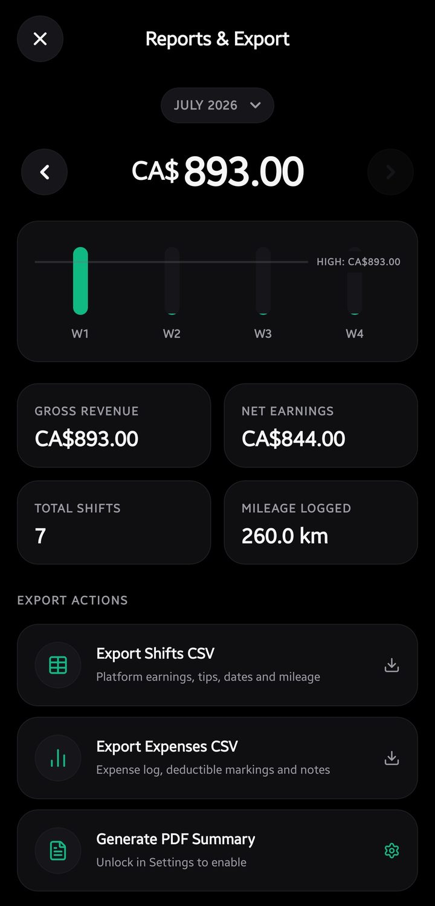
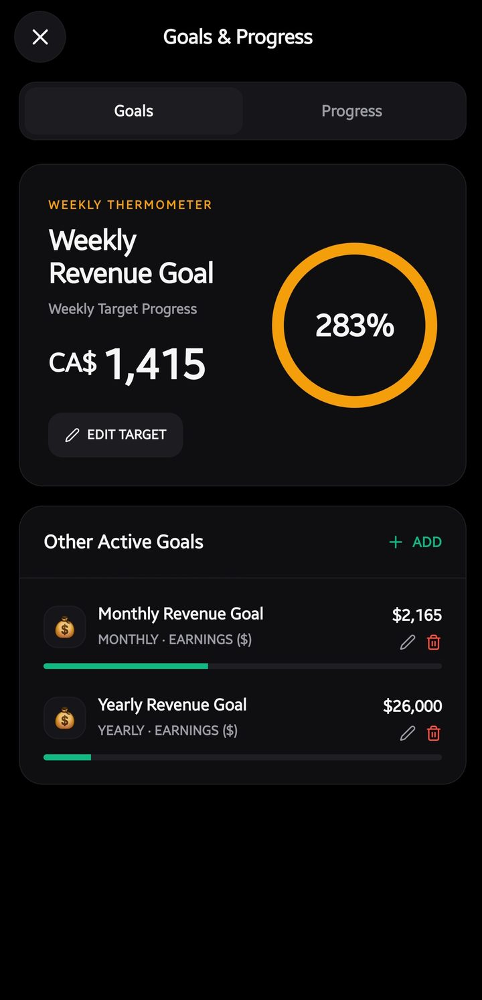
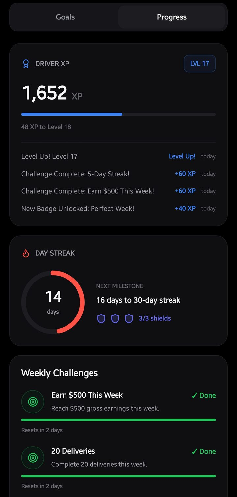
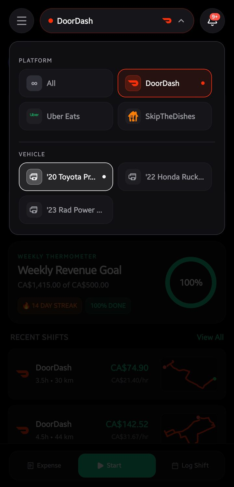

> **Note:** Comma was retired in November 2026 and its repository is archived. [MileWage](/blog/milewage) replaces it. This post is kept as written, except for two claims corrected in November 2026.

**Comma** is an earnings tracker designed for gig workers who deliver for platforms like DoorDash, Uber Eats, SkipTheDishes, and Instacart. This post outlines its features and technical architecture. For detailed technical documentation, refer to the [documentation site](https://comma-docs.vercel.app/) and the GitHub repositories linked at the end.

## Core problem and objectives

Gig workers who use multiple applications often struggle to calculate their true net earnings. Platform applications display gross earnings without accounting for fuel, vehicle maintenance, or tax liabilities. For example, a $200 gross day may result in only $130 of net income. Comma provides business-level accounting tools to calculate these hidden costs accurately.

## Feature overview

Comma records shift routes, distances, and duration automatically via GPS. Users manually log their gross earnings and expenses. The application processes this data to output the following metrics:

- **Net hourly rate:** Calculates true earnings after deducting fuel, maintenance, and vehicle costs.
- **Tax set-aside:** Estimates required tax withholdings based on regional tax rules.
- **Tax-deductible expenses:** Flags eligible expenses automatically.
- **Profitability analysis:** Compares profitability across different platforms and vehicles.

The application categorizes logged expenses and flags deductible items. It generates monthly financial reports and supports CSV exports. Users can manage multiple vehicles, including cars, scooters, and e-bikes.

Comma includes gamification elements such as weekly goals, streaks, XP levels, and badges. These features encourage consistent data logging.

## Local-first architecture and privacy

Comma uses a local-first architecture to ensure data privacy. Financial data stays on the device unless the driver turns on encrypted backup to their own Google Drive. The application requires no user accounts, emails, or passwords. It does not use a central backend server to collect income history. Users can optionally enable encrypted backups to their personal Google Drive.

> **Note:** Because Comma operates entirely offline, users are responsible for backing up their data to prevent loss in case of device failure.

## Application architecture

The project consists of two separate applications that share a compatible backup format:

- **Comma PWA:** A Progressive Web App built with Vanilla JavaScript and IndexedDB. It works offline and runs entirely in the browser.
- **Comma native:** A native Android application built with Expo and React Native. It includes background GPS tracking to record routes and mileage automatically.

Both applications were meant to share one data model, so a backup from one could be restored on the other. An audit in July 2026 found the two had drifted apart; see [Sync engine](/docs/projects/comma/sync-engine).

## Project status and availability

Comma is open-source under the MIT license and contains no paywalls. The tax calculation engine currently supports rules for the US, Canada, UK, and Nepal. The regional system is modular, allowing developers to contribute new regions and platforms easily.

## Explore the project

Review the documentation for setup guides and architecture details: [comma-docs.vercel.app](https://comma-docs.vercel.app/)

The Android app, the web app, and the docs live in one repository:
<LinkCard title="github.com/raiz-toff/Comma" href="https://github.com/raiz-toff/Comma" />
