## Phase 1: Enable nested virtualization

EVE-NG requires nested virtualization to execute node images.

1. SSH into the Proxmox host.
2. Verify the current nested virtualization status by executing the command below:

```bash
cat /sys/module/kvm_intel/parameters/nested
```

> **Note:** For AMD processors, replace `intel` with `amd`. If the output is `Y` (or `1` for AMD), proceed to Phase 2.

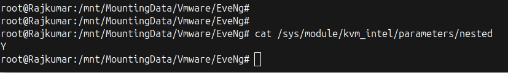

3. Enable nested virtualization by executing the appropriate commands for the processor type.

**For Intel:**
```bash
echo "options kvm-intel nested=Y" > /etc/modprobe.d/kvm-intel.conf
modprobe -r kvm_intel
modprobe kvm_intel
```

**For AMD:**
```bash
echo "options kvm-amd nested=1" > /etc/modprobe.d/kvm-amd.conf
modprobe -r kvm_amd
modprobe kvm_amd
```

---

## Phase 2: Create the Proxmox VM

1. Download the EVE-NG CE 6.2.0-4 ISO from the official website. Upload it to the Proxmox storage via the web interface or TFTP.
2. Click **Create VM** in the Proxmox GUI.

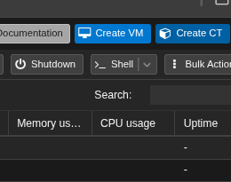

3. Configure the **OS** tab. Select the uploaded EVE-NG ISO and set the Type to `Linux`.

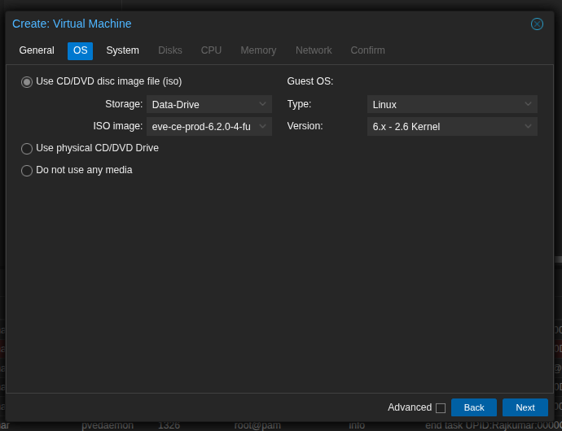

4. Retain the default settings in the **System** tab.
5. Configure the **Disks** tab. Set the Bus/Device to `VirtIO Block`. Allocate a minimum of 50GB of storage.

> **Note:** A storage allocation of 100GB or more is recommended for storing multiple node images.

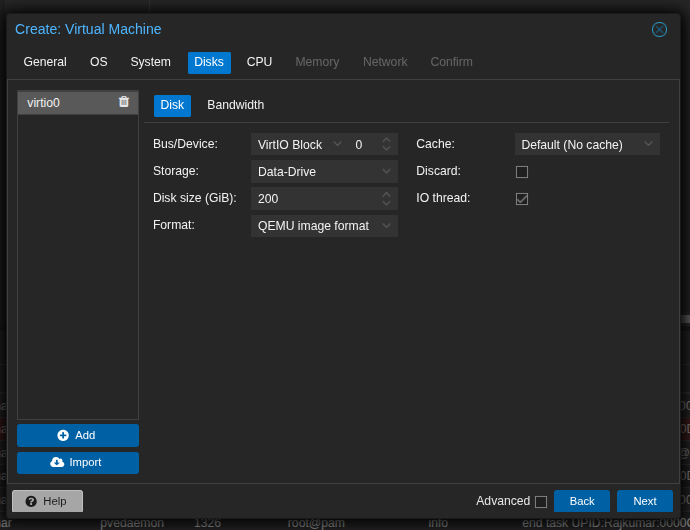

6. Configure the **CPU** tab. Allocate a minimum of 4 cores. Set the CPU Type to `host`. This is mandatory for passing nested virtualization to the VM.

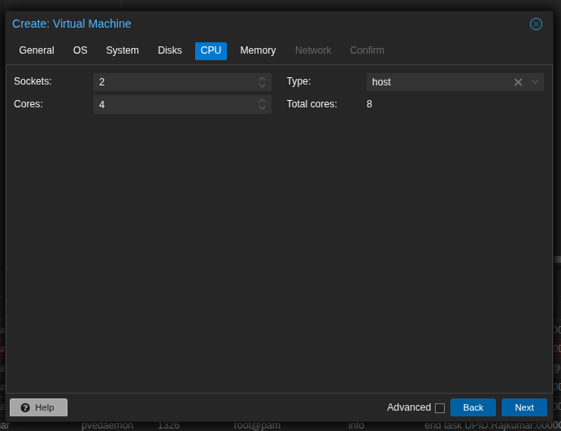

7. Configure the **Memory** tab. Allocate a minimum of 8192 MB (8GB) of RAM. Ensure sufficient host resources are available to prevent boot failures.

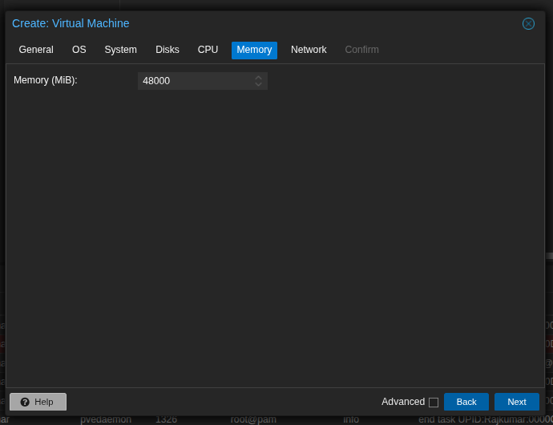

8. Configure the **Network** tab. Bridge the network to `vmbr0` or the designated lab network. Set the Model to `Paravirtualized`.

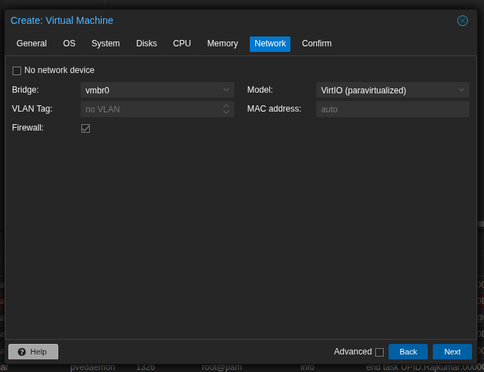

9. Click **Finish**.

---

## Phase 3: Install EVE-NG 6.2.0-4

1. Start the VM and open the Proxmox Console.
2. Select **Install EVE-NG Community 6.2.0-4** at the boot menu.

> **Note:** If partition errors occur, restart the VM and select the "Bare Metal" option.

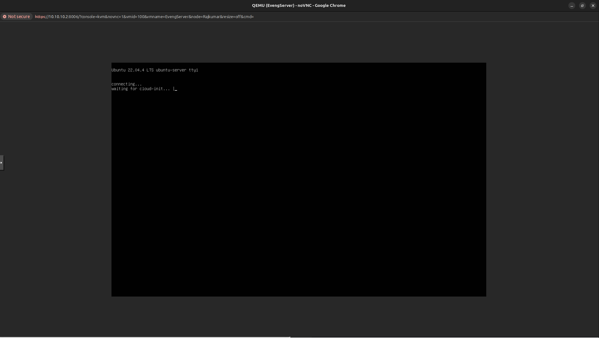

3. Select the preferred language and keyboard layout.

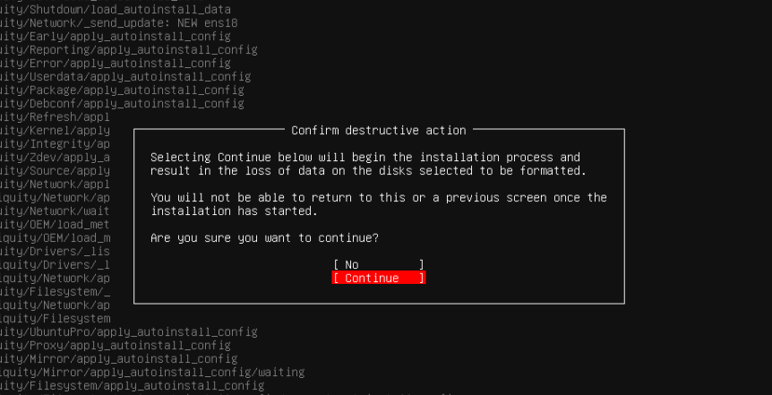

4. Accept the warning to format the virtual disk and install the operating system.
5. Wait for the installation to complete and the VM to reboot.

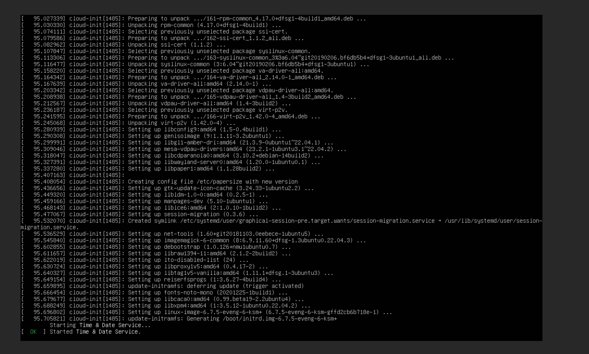

6. Log into the console using the default credentials. Do not access the web interface yet.
   - **Username:** `root`
   - **Password:** `eve`

7. Complete the EVE-NG setup wizard by configuring the following parameters:
   - Root password
   - Hostname and domain
   - Network settings (DHCP or static IP)
   - NTP and DNS servers

8. Wait for the VM to reboot and apply the configuration.
9. Access the assigned IP address via a web browser. Log in to the GUI using the default web credentials (`admin` / `eve`).

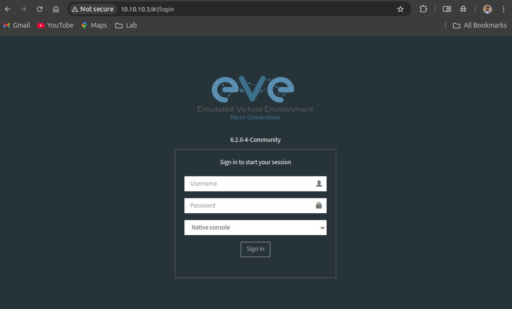
