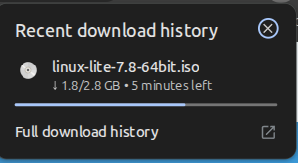
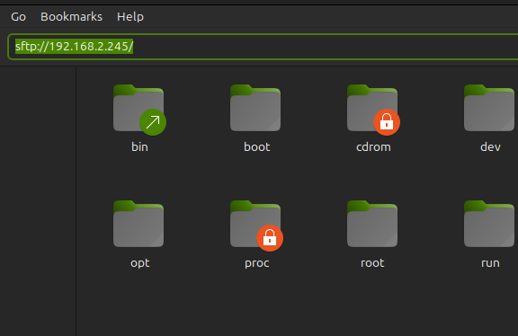
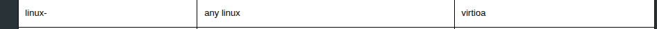
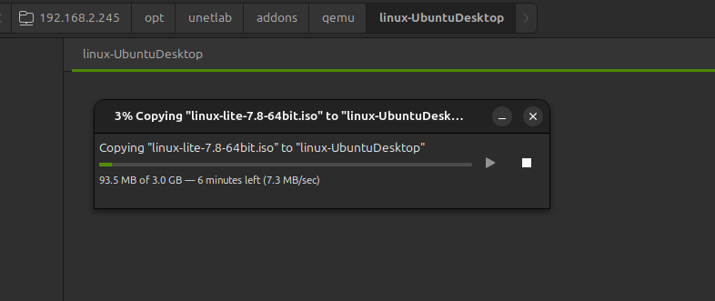

## Overview

This guide details the procedure for setting up a Linux Cloud image in EVE-NG. It uses Linux Lite as an example installation.

1. Download the preferred Linux ISO. For this example, download Linux Lite from [their official website](https://www.linuxliteos.com/download.php).



## Server connection

2. Establish an SFTP connection to the EVE-NG server to upload the image. Windows users can use tools like Nemo or FileZilla. Linux and macOS users can use the native terminal.



3. Authenticate with the EVE-NG server. The default credentials are:
   - **Username:** `root`
   - **Password:** `eve`

## Image directory creation

4. Create a directory for the image on the EVE-NG server. EVE-NG requires a specific naming convention for QEMU images. Consult the [EVE-NG naming documentation](https://www.eve-ng.net/index.php/documentation/qemu-image-namings/) for correct prefixes.



5. Navigate to the QEMU addons directory and create the appropriately named folder. For a Linux image, the prefix must be `linux-`.

```bash
cd /opt/unetlab/addons/qemu/
mkdir linux-lite
cd linux-lite
```

## Image upload and configuration

6. Transfer the downloaded ISO file to the newly created directory via the SFTP connection.




7. Rename the uploaded ISO file to `cdrom.iso`. EVE-NG requires this exact filename to boot from the image.

```bash
mv uploaded_image.iso cdrom.iso
```

8. Open the EVE-NG web interface. Add a new node and select the Linux template. 
9. Start the node and open the VNC console. Complete the standard OS installation process.
