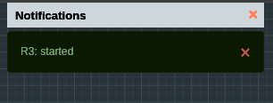
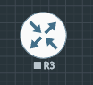
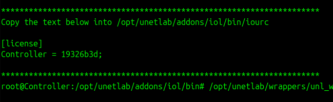

## Troubleshooting Cisco IOL startup failures in EVE-NG

Properly configured Cisco IOL (IOS on Linux) nodes may fail to start within the EVE-NG environment. The dashboard may display a "Node Started" notification, but the node icon remains inactive and console access (via Telnet or HTML) is unavailable.




This issue typically occurs because EVE-NG does not automatically provide licenses for Cisco IOL images. Users must generate a license key specific to the EVE-NG installation's hostname.

## Step-by-step resolution

### 1. Establish SSH connection

Establish an SSH connection to the EVE-NG server and authenticate as the root user.

### 2. Navigate to the IOL binary directory

Navigate to the directory containing the IOL images and license files:

```bash
cd /opt/unetlab/addons/iol/bin/
```

### 3. Create the license generator script

Create a Python script to generate a unique license key based on the virtual machine's ID. 

```bash
nano CiscoIOUKeygen.py
```

Insert the following Python code into the file:

```python
import os
import socket

# Get HostID and Hostname
hostid = os.popen("hostid").read().strip()
hostname = socket.gethostname()

# Convert hex hostid to integer
ioukey = int(hostid, 16)

# Key calculation logic
for x in range(1, len(hostname) + 1):
    ioukey = ioukey ^ ord(hostname[x - 1])
    ioukey = ioukey ^ (ioukey << 8)

# Mask to 32-bit to prevent "int too large" errors
ioukey &= 0xFFFFFFFF
iouLicense = "%016x" % ioukey
iouLicense = iouLicense[8:]

print("\n*********************************************************************")
print("Create the file /opt/unetlab/addons/iol/bin/iourc with this content:")
print("\n[license]")
print(f"{hostname} = {iouLicense};")
print("\n*********************************************************************")
```

Save the file and exit the text editor.

### 4. Generate the license key

Execute the script using Python 3:

```bash
python3 CiscoIOUKeygen.py
```

The script generates a block of text. Copy the specific line formatted as `your-hostname = 0123456789abcdef;`.



### 5. Create the iourc license file

Create a file named `iourc` within the same directory (`/opt/unetlab/addons/iol/bin/`) to store the generated key.

```bash
nano iourc
```

Insert the script output, including the `[license]` header. Ensure the semicolon is included at the end of the line.

```plaintext
[license]
Controller = 0123456789abcdef;
```

> **Note:** The semicolon at the end of the key line is strictly required.

### 6. Apply file permissions

EVE-NG enforces strict file permission requirements. Execute the wrapper script to synchronize permissions across the environment.

```bash
/opt/unetlab/wrappers/unl_wrapper -a fixpermissions
```

## Validation

Return to the EVE-NG web interface and attempt to start the node again. The node icon should turn blue, indicating a successful boot. Console access will now be available for device configuration.
