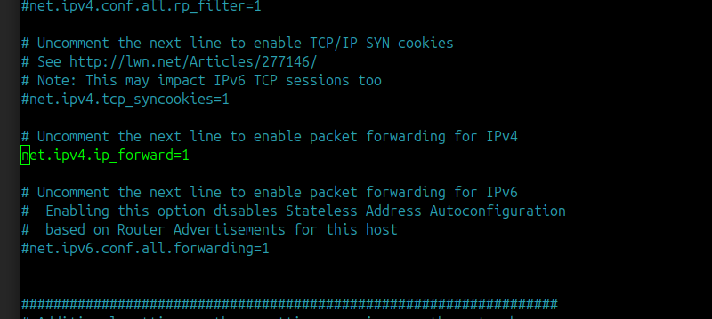

Connecting a headless Proxmox VE server directly to a Linux laptop via Ethernet allows local management when no physical switch port is available. To provide the Proxmox node with internet access through the laptop's Wi-Fi adapter, configure the laptop as a Layer 3 NAT router rather than a Layer 2 bridge.

## Prerequisites

Verify the following hardware and network parameters before applying the routing rules:

- A Linux host laptop connected to an upstream network via Wi-Fi (e.g., `wlan0` or `wlo1`).
- A Proxmox VE server connected directly to the laptop's RJ45 Ethernet port (e.g., `eth0` or `enp3s0`).
- Root or `sudo` privileges on both the Linux host laptop and the Proxmox VE console.
- A dedicated private `/24` subnet for the point-to-point Ethernet link (such as `10.10.10.0/24`) that does not overlap with the Wi-Fi LAN.

## Step 1: Identify network interfaces on the host laptop

Inspect the active network links on the Linux laptop to determine the exact kernel interface names for Wi-Fi and Ethernet.

```bash
ip link
```


Record the wireless interface name (for example, `wlo1` or `wlan0`) and the wired Ethernet interface name (for example, `enp2s0` or `eth0`). Assign a static IP address to the laptop's Ethernet interface so it can act as the default gateway for the Proxmox host:

```bash
sudo ip addr add 10.10.10.1/24 dev eth0
sudo ip link set eth0 up
```

## Step 2: Configure the Proxmox management interface

Update `/etc/network/interfaces` on the Proxmox VE node so its bridged management interface (`vmbr0`) uses the laptop's Ethernet IP (`10.10.10.1`) as its default gateway.

```text
auto lo
iface lo inet loopback

iface eno1 inet manual

auto vmbr0
iface vmbr0 inet static
    address 10.10.10.2/24
    gateway 10.10.10.1
    bridge-ports eno1
    bridge-stp off
    bridge-fd 0
```

Configure a public DNS resolver inside `/etc/resolv.conf` on the Proxmox node, then reload the networking service:

```bash
echo "nameserver 1.1.1.1" > /etc/resolv.conf
systemctl restart networking
```

## Step 3: Enable kernel IP forwarding on the laptop

Enable IPv4 packet forwarding in the Linux kernel on the host laptop. This allows the operating system to route packets between the wired Ethernet interface and the wireless interface.

```bash
sudo sysctl -w net.ipv4.ip_forward=1
```



## Step 4: Configure iptables NAT masquerading rules

Apply `iptables` rules on the Linux laptop to masquerade outbound traffic from the Ethernet interface behind the laptop's Wi-Fi IP address. Replace `wlan0` and `eth0` in the commands below with the interface names identified in Step 1.

```bash
# 1. Flush existing filter and NAT rules
sudo iptables -F
sudo iptables -t nat -F

# 2. Enable source NAT (masquerading) on the outbound Wi-Fi interface
sudo iptables -t nat -A POSTROUTING -o wlan0 -j MASQUERADE

# 3. Permit forwarding from the wired Ethernet link to Wi-Fi
sudo iptables -A FORWARD -i eth0 -o wlan0 -j ACCEPT
sudo iptables -A FORWARD -m conntrack --ctstate RELATED,ESTABLISHED -j ACCEPT
```

> **Note:** Executing `iptables -F` clears all active firewall rules in the filter table. If the host laptop runs Docker, libvirt, or custom firewall chains, omit the flush commands and append only the `POSTROUTING` and `FORWARD` rules.

Test connectivity from the Proxmox VE shell by pinging an external IP address and resolving a domain name:

```bash
ping -c 4 1.1.1.1
ping -c 4 deb.debian.org
```

## Step 5: Persist forwarding and firewall rules across reboots

Runtime `sysctl` and `iptables` changes reset when the host laptop reboots. Make both settings permanent using the steps below:

- **Kernel forwarding persistence:** Open `/etc/sysctl.conf` (or create `/etc/sysctl.d/99-ipforward.conf`) and set `net.ipv4.ip_forward=1`.
- **Firewall rule persistence:** Install `iptables-persistent` on Debian or Ubuntu hosts to save and reload the active netfilter tables automatically at boot.

```bash
sudo apt update
sudo apt install -y iptables-persistent
sudo netfilter-persistent save
```

## Why Layer 2 Wi-Fi bridging fails

Standard IEEE 802.11 client connections use a three-address frame header format that does not support arbitrary source MAC addresses behind a single wireless station. Most Wi-Fi Access Points (APs) also enforce port security or MAC association tables that permit only the authenticated client's hardware address.

When you bridge a wired interface (`eth0`) directly to a wireless interface (`wlan0`), frames originating from the Proxmox server egress with Proxmox's hardware MAC address. The upstream AP does not recognize that unauthenticated MAC address in its association table and silently drops the frames.

## How Layer 3 NAT resolves the MAC restriction

Routing at Layer 3 isolates the wired Ethernet broadcast domain from the wireless network. When the Proxmox server sends a packet to the internet, the traffic follows a four-stage path:

- The Proxmox node encapsulates the packet in an Ethernet frame addressed to the laptop's `eth0` MAC address (`10.10.10.1`).
- The Linux kernel strips the Layer 2 Ethernet header and consults its routing table to forward the IP packet toward `wlan0`.
- The `iptables` `MASQUERADE` target rewrites the source IP address to the laptop's Wi-Fi IP and tracks the session in `conntrack`.
- The wireless driver encapsulates the packet in an 802.11 frame using the laptop's own authorized Wi-Fi MAC address, which the upstream AP accepts and forwards.
