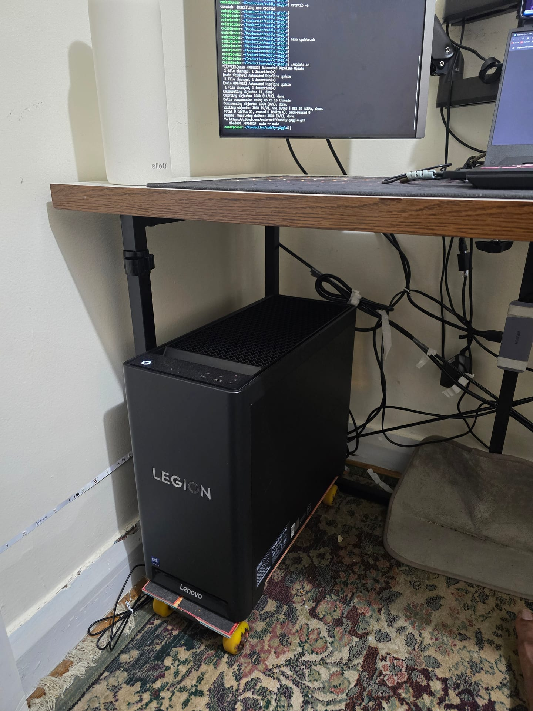
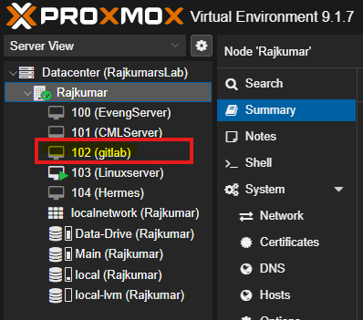
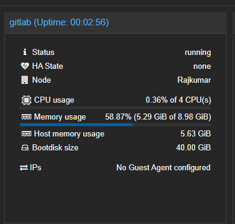
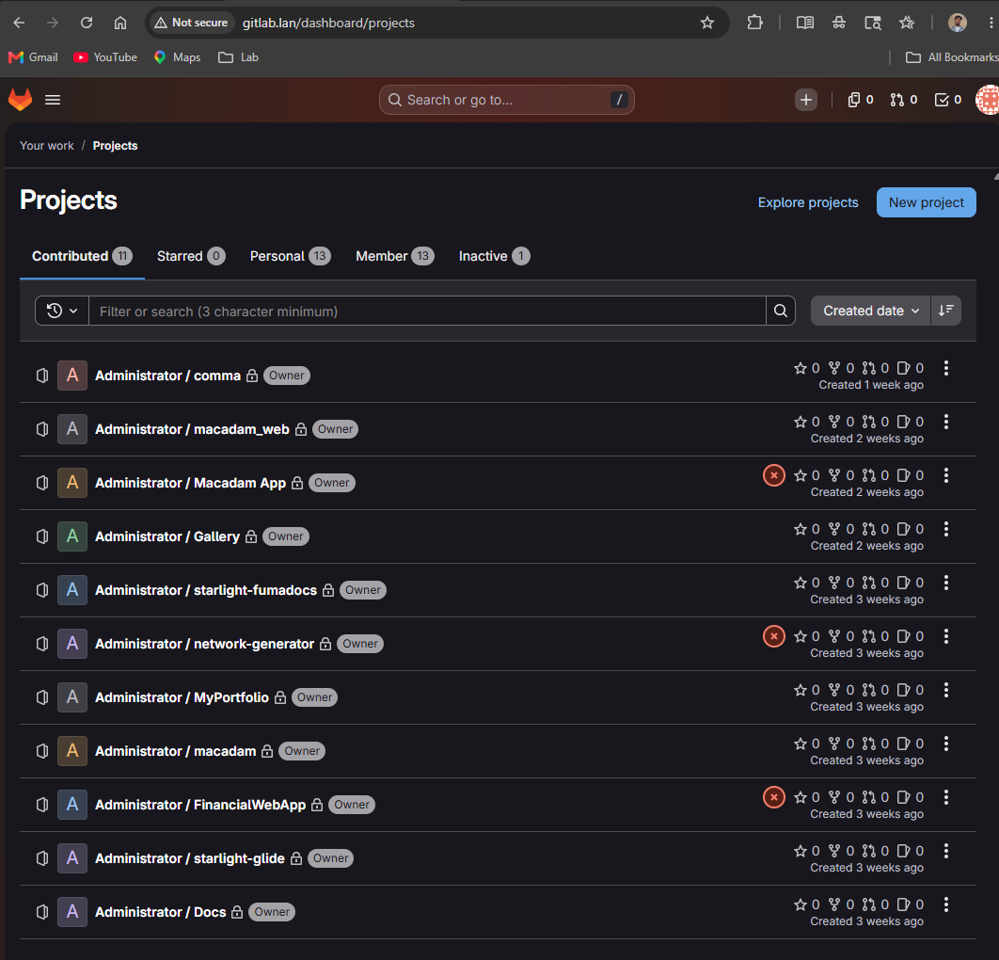
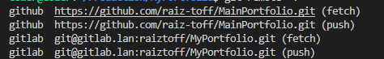

Hosting a local GitLab instance enables experimentation with pipelines, automation, and registry configurations without consuming cloud resources. 

## Architecture decision: VM vs. LXC

Many community tutorials recommend deploying GitLab within a Proxmox LXC container to conserve resources. However, this approach often introduces systemd and permission complexities. 

<Callout type="warn" title="Gotcha">
**Goal:** Install GitLab inside a Proxmox LXC container.

**Reality:** GitLab is highly resource-intensive. Running its omnibus package inside an unprivileged LXC container causes complex mounting and systemd failures.

**Fix:** Deploying GitLab on a standard Virtual Machine (VM) provides a cleaner environment and resolves systemd integration issues natively.
</Callout>

## Hardware allocation

GitLab documentation specifies a minimum requirement of 4GB RAM, 2 vCPUs, and 25GB of storage. To ensure stable operation for omnibus services, these allocations were doubled for this deployment.

> **Note:** GitLab requires a significant amount of time to execute initial startup and reconfiguration tasks. 

## Network configuration

For a persistent local server, relying on DHCP assignments creates instability for Git remotes.

<Callout type="warn" title="Gotcha">
**Goal:** Ensure persistent local domain resolution to the GitLab instance using a host file.

**Reality:** DHCP assigned a new IP address upon reboot, breaking DNS resolution and server access.

**Fix:** Assign a static IP address to the GitLab VM via Proxmox network interface settings and update local host files accordingly.
</Callout>

## Project migration and remotes

Managing multiple Git remotes for a single repository requires a structured approach. Designate one remote as the primary upstream (e.g., `origin` pointing to the local GitLab server) and configure secondary remotes (e.g., `production` pointing to GitHub) for release deployments.

