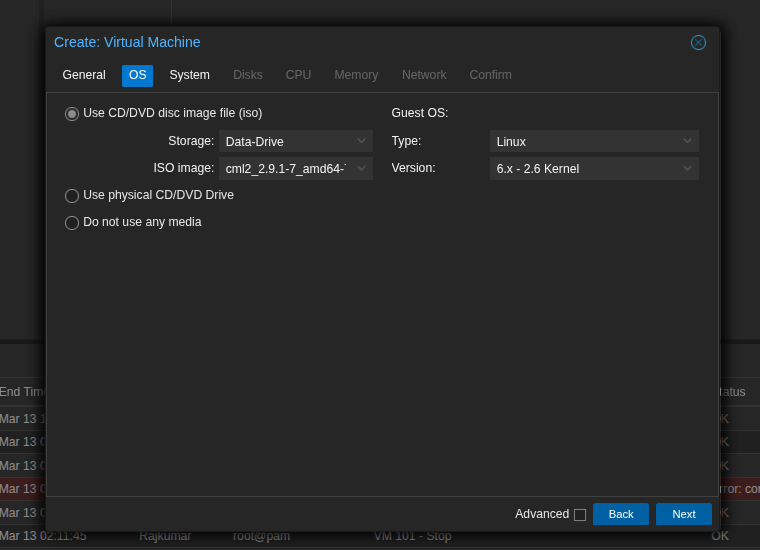
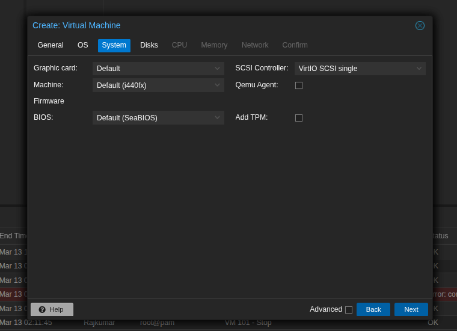
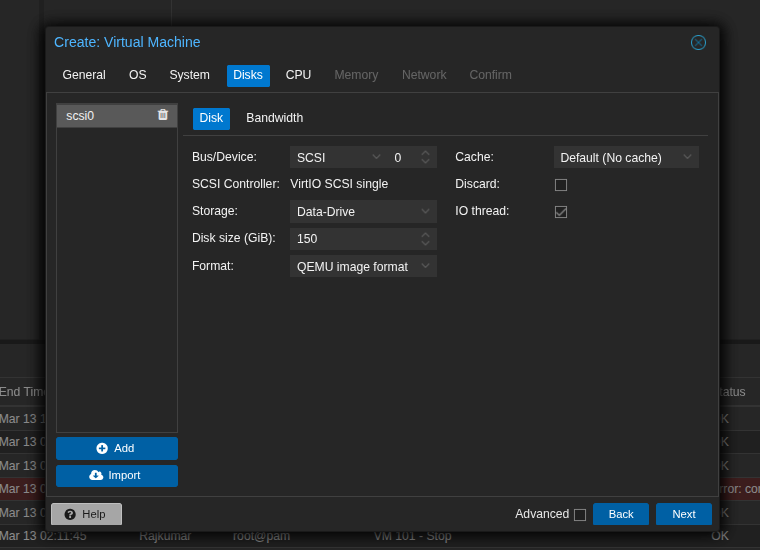
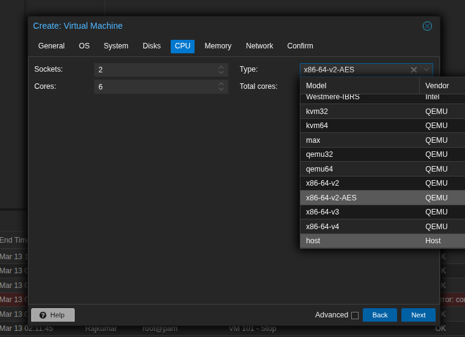
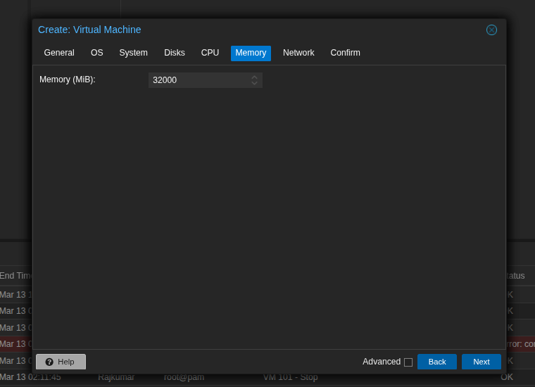
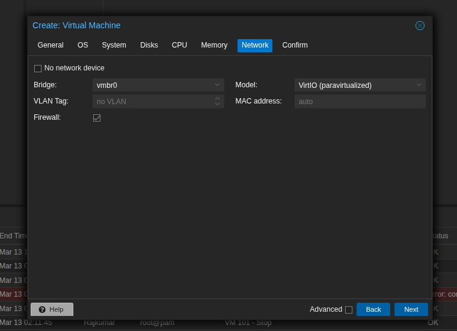
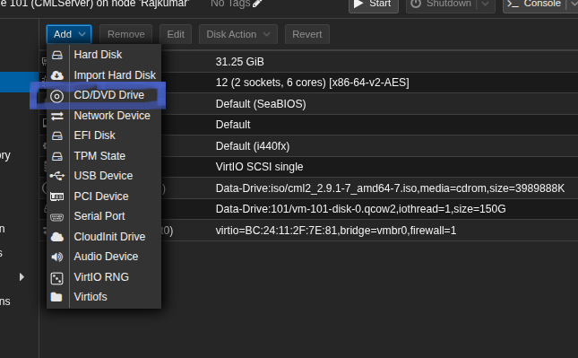
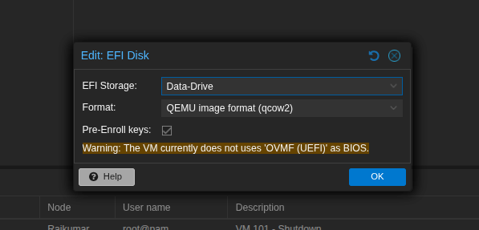
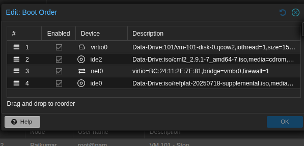
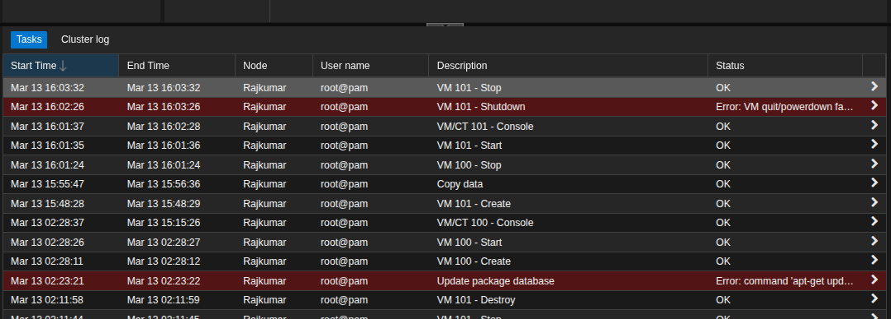

## Prerequisites

- Active Proxmox VE server
- Cisco CML Personal license
- Required CML ISO files from Cisco:
  - CML Installer ISO (e.g., `cml2.9.1-7.iso`)
  - CML Reference Platform ISO (e.g., `refplate_2.9.1.iso`)

## Step 1: Enable nested virtualization

Cisco CML requires nested virtualization to execute router and switch nodes. Execute the following commands on the Proxmox host shell:

1. Verify the current nested virtualization status:
   ```bash
   cat /sys/module/kvm_intel/parameters/nested
   ```
   *(For AMD processors, query `kvm_amd` instead).* The output must be `Y` or `1`.

2. If the feature is disabled, apply the appropriate configuration:
   - **Intel:** `echo "options kvm-intel nested=Y" > /etc/modprobe.d/kvm-intel.conf`
   - **AMD:** `echo "options kvm-amd nested=1" > /etc/modprobe.d/kvm-amd.conf`

3. Reboot the Proxmox host or reload the KVM module to apply changes.

## Step 2: Upload CML images

1. Navigate to the designated storage drive within the Proxmox interface (e.g., `local`).
2. Select **ISO Images** and click **Upload**.
3. Upload the CML Installer ISO and the Reference Platform ISO to the storage array.

## Step 3: Configure the virtual machine

Create a new virtual machine using the following parameters:

- **General:** Assign a hostname (e.g., `CML-Personal`).
- **OS:** Select the uploaded CML Installer ISO. Set Guest OS to Linux (6.x - 2.6 Kernel).
  
- **System:** Retain default settings (OVMF, i440fx).
  
- **Disks:** Allocate a minimum of 32 GB using SCSI or VirtIO.
  > **Note:** An allocation of 150GB or higher is recommended to accommodate external images and lab topologies.
  
- **CPU:** Allocate a minimum of 4 cores. The CPU Type must be set to **Host** to pass nested virtualization to the guest.
  
- **Memory:** Allocate a minimum of 8192 MB of RAM. Higher allocations (16384 MB+) are recommended for stable operation.
  
- **Network:** Use VirtIO (Paravirtualized) bridged to the active network interface (e.g., `vmbr0`).
  

## Step 4: Mount the Reference Platform ISO

Execute these actions before initiating the VM boot sequence:

1. Navigate to the VM's **Hardware** tab.
2. Select **Add** > **CD/DVD Drive**.
   
3. Attach the CML Reference Platform ISO to an available IDE or SCSI interface.
4. Add an EFI disk to the hardware configuration.
    
5. Verify the boot order configuration.
   

> **Note:** Monitor the Proxmox task log for configuration errors during deployment.


## Step 5: Execute CML installation

1. Start the VM and access the console view.
2. Complete the text-based setup prompts, configuring the timezone, administrative credentials, and network settings.
3. Select **Copy to Disk** when prompted regarding the Reference Platform. This transfers the lab images to the virtual hard drive.
4. The VM will output its assigned IP address upon successful installation.

## Step 6: Licensing and access

1. Access the CML web interface via `https://<CML-VM-IP>`.
2. Authenticate using the configured administrative credentials.
3. Navigate to **Tools** > **Licensing** and register the instance using a valid CML Personal token.
