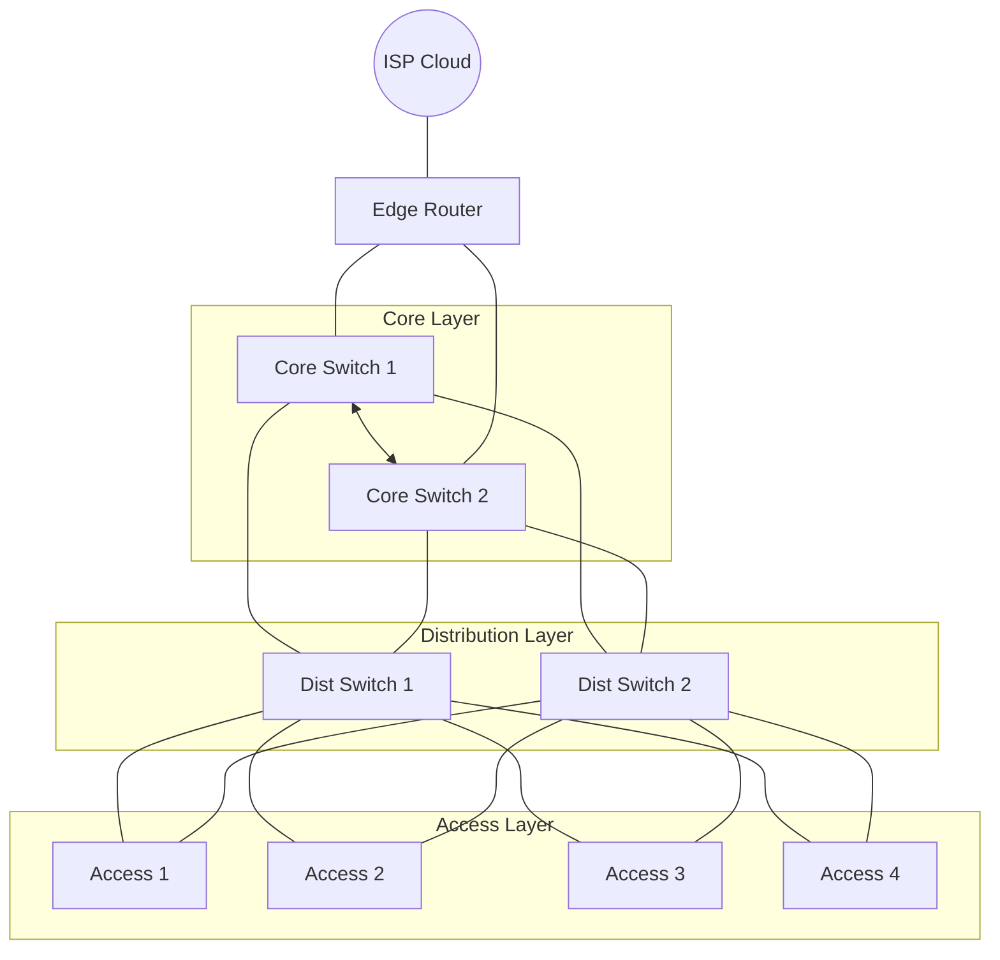

## Project objective

Design and automate the deployment of a campus network. Use Ansible or Python (Netmiko/Nornir). Provision VLANs, inter-VLAN routing, OSPF, STP tuning, SSH hardening, and baseline configurations from a single command.

---

## Recommended lab scale

### Core design principle

Design the network to simulate a realistic campus environment. Keep the topology small enough to build in EVE-NG, GNS3, or Cisco CML.

### Node count 

Deploy 12 to 16 total devices.

**Core Layer (2 devices)**
- Deploy 2 Layer 3 Core Switches (Core1, Core2).

**Distribution Layer (2 devices)**
- Deploy 2 Layer 3 Distribution Switches (Dist1, Dist2).

**Access Layer (4 devices)**
- Deploy 4 Layer 2 Access Switches (Access1–Access4).

**Edge / WAN (1 device)**
- Deploy 1 Edge Router to simulate an ISP link.

**Management / Services (2–3 nodes)**
- Deploy 1 Automation Host (Ansible control node).
- Deploy 1 Syslog/NTP server.
- Deploy 1 Test Client VM.

Scale the access switches to 6–8 devices to increase complexity.

---

## Topology architecture

### Hierarchical three-tier campus

| Source Device | Source Port | Destination Device | Destination Port |
| ------------- | ----------- | ------------------ | ---------------- |
| ISP (Cloud)   | N/A         | EdgeRouter         | `Gi0/0`          |
| EdgeRouter    | `Gi0/1`     | Core1              | `e0/0`           |
| EdgeRouter    | `Gi0/2`     | Core2              | `e0/0`           |
| Core1         | `e0/1`      | Core2              | `e0/1`           |
| Core1         | `e0/2`      | Core2              | `e0/2`           |
| Core1         | `e1/0`      | Distribution1      | `e0/0`           |
| Core1         | `e0/3`      | Distribution2      | `e0/1`           |
| Core2         | `e1/0`      | Distribution2      | `e0/0`           |
| Core2         | `e0/3`      | Distribution1      | `e0/1`           |
| Distribution1 | `e1/0`      | Access1            | `Gi0/0`          |
| Distribution1 | `e1/1`      | Access2            | `Gi0/0`          |
| Distribution1 | `e1/2`      | Access3            | `Gi0/0`          |
| Distribution1 | `e1/3`      | Access4            | `Gi0/0`          |
| Distribution2 | `e1/1`      | Access1            | `Gi0/1`          |
| Distribution2 | `e1/0`      | Access2            | `Gi0/1`          |
| Distribution2 | `e1/2`      | Access3            | `Gi0/1`          |
| Distribution2 | `e1/3`      | Access4            | `Gi0/1`          |
| Access1       | `Gi0/2`     | Node10 (Laptop)    | `e0`             |
| Access2       | `Gi0/2`     | Linux (Server)     | `e0`             |
| Access3       | `Gi0/2`     | Linux (Workstation)| `e0`             |
| Access4       | `Gi0/2`     | TestingLinux       | `e0`             |

### Design logic

- Configure Layer 3 links between Core switches.
- Configure Layer 3 links (OSPF area 0) between Core and Distribution layers.
- Configure Layer 2 trunks between Distribution and Access layers.
- Configure Inter-VLAN routing on the Distribution layer.
- Configure a default route from Core to Edge.
- Configure OSPF between Core and Distribution.

---

## VLAN and IP plan

Example VLAN assignments:

- VLAN 10: Users
- VLAN 20: Servers
- VLAN 30: Voice
- VLAN 40: Management

Example IP addressing:

- `10.10.10.0/24`: Users
- `10.10.20.0/24`: Servers
- `10.10.30.0/24`: Voice
- `10.10.40.0/24`: Management

Use `/30` or `/31` subnets for routed point-to-point links.

---

## Automation scope

Ensure the automation script executes the following actions:

1. Configure hostnames.
2. Configure the domain name.
3. Generate RSA keys.
4. Enable SSH and disable Telnet.
5. Create a local admin user.
6. Configure NTP and Syslog.
7. Configure VLANs and names.
8. Configure trunk ports.
9. Configure access ports.
10. Configure SVIs on the Distribution layer.
11. Enable OSPF.
12. Configure the default route on the Core.
13. Set STP root primary and secondary.
14. Save the configuration.

---

## Automation architecture

### Option A: Ansible

Organize the directory structure:

- `inventory.yaml`
- `group_vars/`
- `roles/`
  - `base_config/`
  - `vlan/`
  - `ospf/`
  - `stp/`

Use the following Ansible modules:

- `ios_config`
- `ios_vlan`
- `ios_l3_interfaces`
- `ios_ospfv2`

### Option B: Python

Use the following libraries:

- Netmiko to push CLI commands.
- Nornir to structure the inventory.
- Jinja2 to generate templates.

Organize the directory structure:

- `inventory.yaml`
- `templates/`
  - `base.j2`
  - `vlan.j2`
  - `ospf.j2`
- `deploy.py`

---

## Advanced features

Implement these optional features to enhance the project:

- Add an idempotency check.
- Add a rollback mechanism.
- Add a configuration validation step.
- Verify OSPF neighbors automatically.
- Verify VLAN presence automatically.
- Generate a post-deployment report.

---

## Final deliverables

Provide the following project deliverables:

1. Create a topology diagram using draw.io.
2. Publish a GitHub repository.
3. Write a README to explain the architecture.
4. Provide a before-and-after configuration comparison.
5. Record a demonstration video.

---

## Conclusion

This project covers network design, routing logic, and Infrastructure as Code principles.
