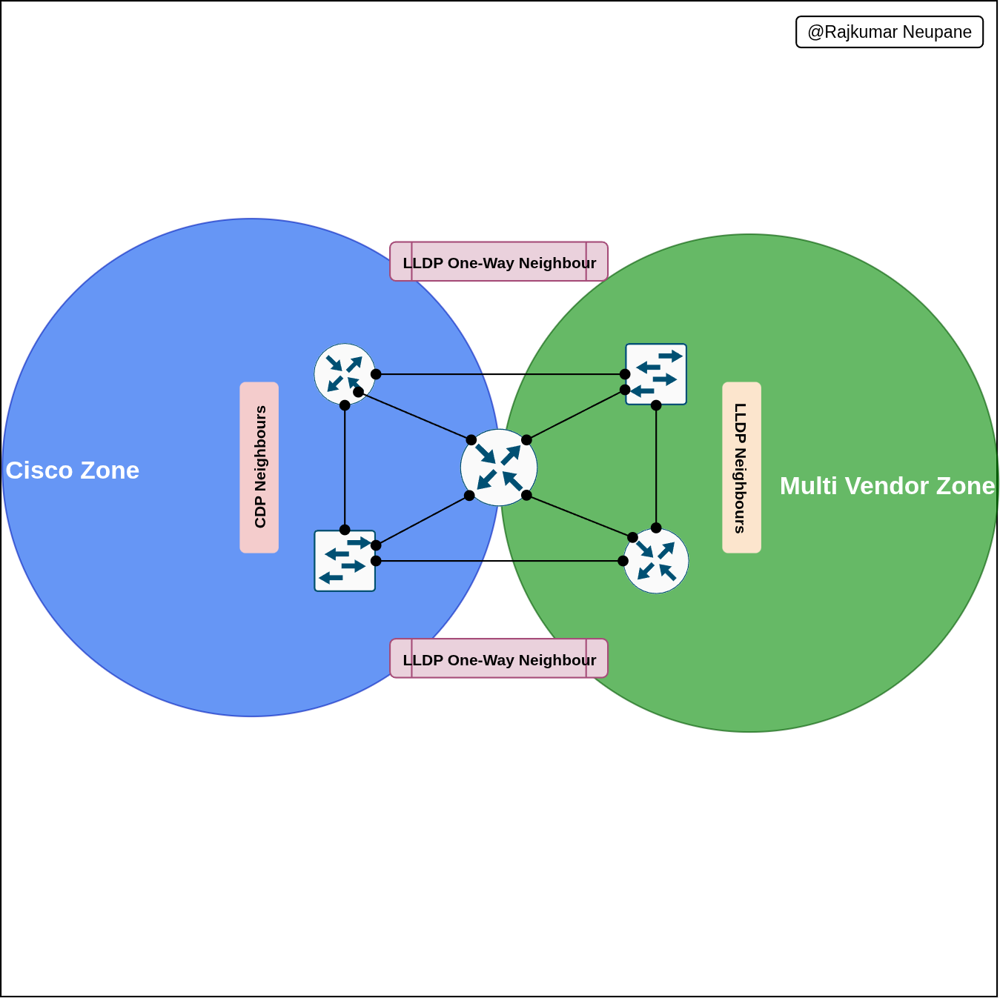

## Scenario overview

Configure CDP on routers and switches that connect to Cisco equipment. Configure LLDP on ports facing third-party or open-standard devices. Configure discovery protocols per interface to control link behavior.

## Implementation summary

| Device | Cisco Zones (CDP) | Multi-Vendor Zones (LLDP) | Protocol Behavior | Notes / Purpose |
| ------ | ----------------- | ------------------------- | ----------------- | --------------- |
| Router1 | `e0/1`, `e0/2` | `e0/0`, `e0/3` | CDP enabled on Cisco zones. LLDP transmit-only on multi-vendor links. | Prevents overlap. Shares link info with non-Cisco devices. |
| Router2 | `e0/0`, `e0/2` | `e0/1`, `e0/3` | CDP and LLDP separated by interface. | Enforces protocol boundaries. Avoids duplicate discovery. |
| Router3 | — | All Ethernet ports | LLDP transmit-only on `e0/2`. CDP active on select links. | Ensures LLDP visibility. Maintains backward Cisco compatibility. |
| Switch1 | `e0/0`, `e0/1` | `e0/2` (receive-only) | CDP for Cisco links. LLDP receive-only on multi-vendor port. | Bridges Cisco and multi-vendor zones. |
| Switch2 | — | `e0/0` to `e0/3` | LLDP transmit/receive on all. CDP disabled. | Creates pure LLDP environment for testing. |

## Network topology result

Verify that the topology cleanly divides discovery domains.
- Ensure CDP zones handle internal Cisco-to-Cisco connectivity.
- Ensure LLDP zones handle external or third-party interoperability points.



## Device configurations

### Configure Router1

1. Configure CDP on `e0/1` and `e0/2` (Cisco zone).
1. Configure LLDP on `e0/0` (Tx/Rx) and `e0/3` (Tx only).

```bash
conf t
! --- Enable CDP globally
cdp run
! --- Enable LLDP globally
lldp run

! --- CDP-enabled interfaces
int e0/1
 cdp enable
 no lldp transmit
 no lldp receive
exit

int e0/2
 cdp enable
 no lldp transmit
 no lldp receive
exit

! --- Unused Port 
int e0/0
 no cdp enable
 no lldp transmit
 no lldp receive
exit
! --- LLDP-enabled interface
int e0/3
 no cdp enable
 lldp transmit
 no lldp receive
exit
```

### Configure Router2

1. Configure CDP on `e0/0` and `e0/2`.
1. Configure LLDP on `e0/1` and `e0/3`.

```bash
conf t
cdp run
lldp run

! --- CDP zone
int e0/0
 cdp enable
 no lldp transmit
 no lldp receive
exit

int e0/2
 cdp enable
 no lldp transmit
 no lldp receive
exit

! --- LLDP zone
int e0/1
 no cdp enable
 lldp transmit
 lldp receive
exit

int e0/3
 no cdp enable
 lldp transmit
 lldp receive
exit
```

### Configure Router3

1. Disable CDP globally.
1. Configure LLDP on all Ethernet ports (Tx/Rx), except `e0/2` (Tx only).

```bash
conf t
no cdp run
lldp run

! --- LLDP on all Ethernet
int e0/0
 lldp transmit
 lldp receive
exit
! --- UNused Port
int e0/1
 no lldp transmit
 no lldp receive
exit

int e0/2
 lldp transmit
 no lldp receive
exit

int e0/3
 lldp transmit
 lldp receive
exit

! --- CDP kept for Serial interfaces in CML entering Serial interface of this device is not permit
int range s1/0 - 1/3
 no lldp transmit
 no lldp receive
exit

end
wr
```

### Configure Switch1

1. Configure CDP on `e0/0` and `e0/1`.
1. Configure LLDP receive-only on `e0/2`.

```bash
conf t
cdp run
lldp run

! --- Cisco zone (CDP)
int e0/0
 cdp enable
 no lldp transmit
 no lldp receive
exit

int e0/1
 cdp enable
 no lldp transmit
 no lldp receive
exit

! --- Multi-vendor receive-only LLDP
int e0/2
 no cdp enable
 no lldp transmit
 lldp receive
exit

! --- Disable LLDP entirely on e0/3
int e0/3
 no cdp enable
 no lldp transmit
 no lldp receive
exit

end
wr
```

### Configure Switch2

1. Disable CDP globally.
1. Configure LLDP on all interfaces (Tx/Rx), except `e0/3` (Rx-only).

```bash
conf t
no cdp run
lldp run

! --- LLDP full Tx/Rx
int range e0/0 - 2
 no cdp enable
 lldp transmit
 lldp receive
exit

! --- LLDP Rx-only
int e0/3
 no cdp enable
 no lldp transmit
 lldp receive
exit

end
```

## Summary table

| Device | CDP Interfaces | LLDP Interfaces | Special Cases |
| ------ | -------------- | --------------- | ------------- |
| Router1 | `e0/1`, `e0/2` | `e0/0` (Tx/Rx), `e0/3` (Tx only) | — |
| Router2 | `e0/0`, `e0/2` | `e0/1`, `e0/3` | — |
| Router3 | `e0/1`, Serial | `e0/0`, `e0/1`, `e0/3` | `e0/2` Tx only |
| Switch1 | `e0/0`, `e0/1` | `e0/2` Rx only | — |
| Switch2 | — | `e0/0` to `e0/2` (Tx/Rx) | `e0/3` Rx only |

Lab files are kept in the [NetworkingLabFiles repository](https://github.com/raiz-toff/NetworkingLabFiles).
