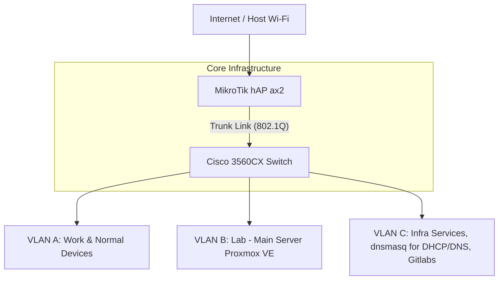

## Lab objectives

Deploy a private, hardware-isolated network in a shared living environment. Ensure lab experiments remain secure and independent from the primary household Wi-Fi. Simulate network software such as EVE-NG, GNS3, Proxmox VE, Packet Tracer, and Cisco CML.

## Network topology

1. Configure a Router-on-a-Stick (RoaS) topology. 
1. Use a MikroTik gateway for inter-VLAN routing. 
1. Use a Cisco Catalyst switch for physical distribution.

## Network segmentation

<CardGrid stagger>
  <Card title="VLAN A: Work" icon="laptop">
    Assign the work laptop and everyday devices to their own broadcast domain. Isolate them from the lab traffic.
  </Card>
  <Card title="VLAN B: Lab" icon="setting">
    Deploy the Proxmox VE server in this VLAN for EVE-NG nodes and network simulations.
  </Card>
  <Card title="VLAN C: Infrastructure" icon="document">
    Run local DNS, DHCP (Dnsmasq), and Gitlabs for the entire lab in this dedicated segment.
  </Card>
</CardGrid>

## Hardware stack

<CardGrid>
  <Card title="MikroTik hAP ax²" icon="rocket">
    Configure this device as the gateway and router. Route all Inter-VLAN traffic. Manage the wireless uplink to the internet.
  </Card>
  <Card title="Cisco 3560CX" icon="setting">
    Configure this 8-port PoE+ switch for core switching. Manage Layer 2 traffic. Provide power to lab endpoints.
  </Card>
</CardGrid>

## Implementation steps

<Steps>
1. **Acquire hardware**
   - Source the core MikroTik and Cisco components.
   - Select compact hardware for a portable setup.

1. **Configure RouterOS**
   - Install RouterOS 7.
   - Configure the wireless WAN bridge.
   - Configure the initial VLAN tagging.

1. **Integrate Cisco switch**
   - Align the Cisco VLAN database with the MikroTik design.
   - Verify 802.1Q trunking and Inter-VLAN connectivity.

1. **Integrate Proxmox VE**
   - Install Proxmox VE on the lab server.
   - Configure the management interface.
   - Integrate the interface with the lab network.
</Steps>
