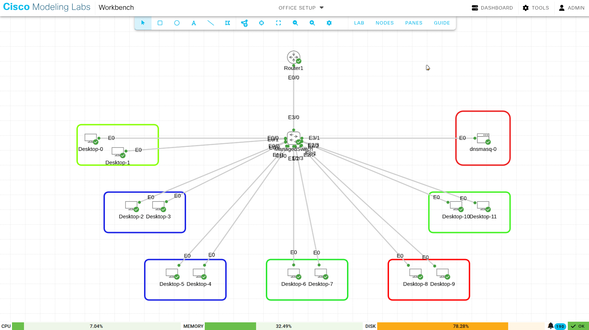
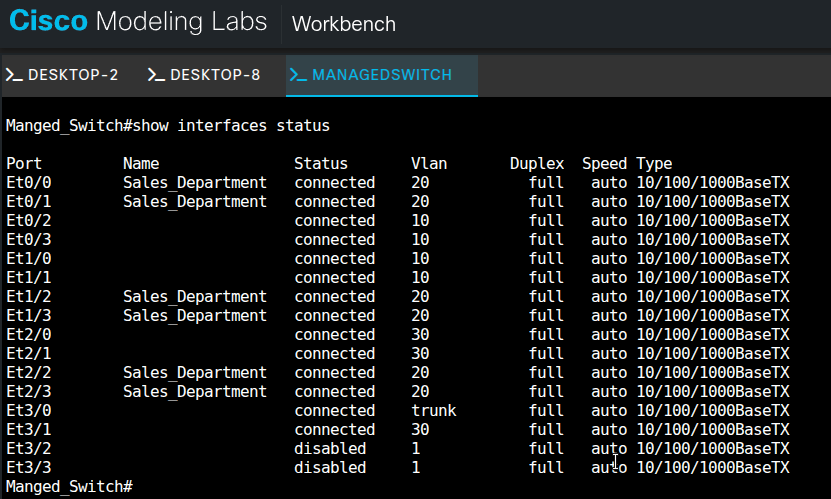
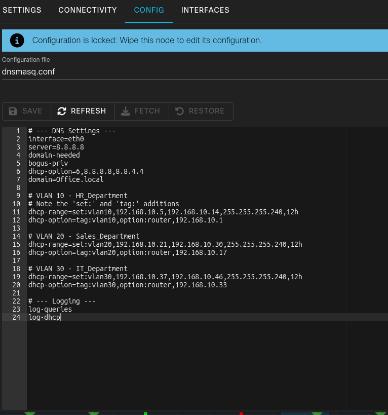
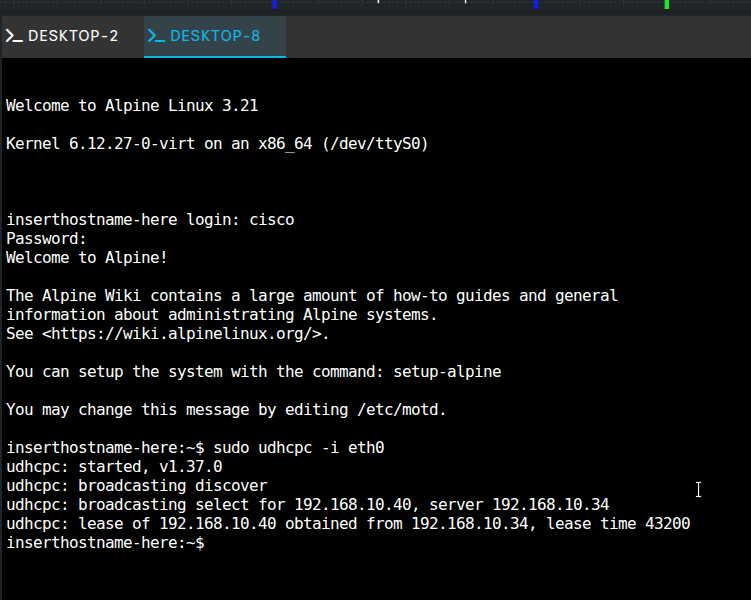
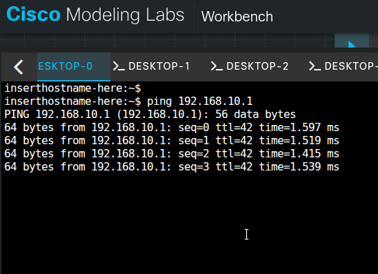
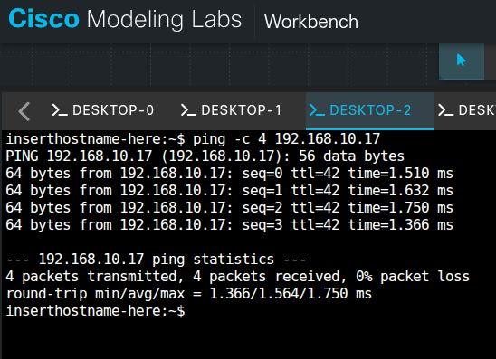

## Lab objectives

Design the office lab network. Configure a Router-on-a-Stick (ROAS) setup for inter-VLAN routing. Deploy a central Dnsmasq server for IP addressing and name resolution. 

<LinkButton href="https://github.com/raiz-toff/NetworkingLabFiles/blob/main/Office_SetupRouterOnAStickLABCML.yaml" icon="external" size="large">Download the CML lab file</LinkButton>

> 

## Hardware inventory

Review the required hardware for this deployment.

**Table 1: Equipment List**

| Device Type | Quantity | Description                  | Role                                        |
| ----------- | -------- | ---------------------------- | ------------------------------------------- |
| Router      | 1        | Cisco IOSv Router            | WAN Gateway, Inter-VLAN Routing (ROAS)      |
| Switch      | 1        | Cisco IOSv-L2 Managed Switch | Access Layer, VLAN Segmentation (802.1Q)    |
| Endpoints   | 12       | Alpine Linux Desktops        | End-user workstations for HR, Sales, and IT |
| Server      | 1        | Dnsmasq Docker Container     | DHCP and DNS Services (Hosted in IT_MGMT)   |

## Network topology and VLAN design

1. Configure four VLANs to separate department traffic.
1. Configure sub-interfaces on the router to route traffic between the VLANs.

**Table 2: VLAN Configuration**

| VLAN ID | Name       | Department      | Subnet             | Gateway IP      |
| ------- | ---------- | --------------- | ------------------ | --------------- |
| 10      | HR_DATA    | Human Resources | `192.168.10.0/28`  | `192.168.10.1`  |
| 20      | SALES_DATA | Sales           | `192.168.10.16/28` | `192.168.10.17` |
| 30      | IT_MGMT    | IT Support      | `192.168.10.32/28` | `192.168.10.33` |
| 99      | NATIVE     | Management      | `192.168.10.48/28` | `192.168.10.49` |

## Switch port assignment

1. Assign access ports per department on the managed switch.
1. Assign a trunk port for the router uplink.
1. Configure Port Security to limit each access port to a single MAC address.
1. Configure Spanning-Tree PortFast to bypass listening and learning states on access ports.

**Table 3: Physical Port Mapping**

| Switch Interface                             | VLAN  | Department | Connected Device              |
| -------------------------------------------- | ----- | ---------- | ----------------------------- |
| `Et0/2`, `Et0/3`, `Et1/0`, `Et1/1`           | 10    | HR         | Desktops 2, 3, 5, 6           |
| `Et0/0`, `Et0/1`, `Et1/2`, `Et1/3`, `Et2/2`, `Et2/3` | 20    | Sales      | Desktops 0, 1, 6*, 7, 10, 11  |
| `Et2/0`, `Et2/1`                             | 30    | IT         | Desktops 8, 9                 |
| `Et3/1`                                      | 30    | IT         | Dnsmasq Server                |
| `Et3/0`                                      | Trunk | Uplink     | Router1 (`Ethernet 0/0`)      |

> 

## Core services configuration

### Configure DHCP and DNS

1. Deploy a central Dnsmasq server at `192.168.10.34`.
1. Configure tagging logic to provide unique gateways for each VLAN.

**Dnsmasq Configuration:**

```bash
# VLAN 10 - HR_Department
dhcp-range=set:vlan10,192.168.10.5,192.168.10.14,255.255.255.240,12h
dhcp-option=tag:vlan10,option:router,192.168.10.1

# VLAN 20 - Sales_Department
dhcp-range=set:vlan20,192.168.10.21,192.168.10.30,255.255.255.240,12h
dhcp-option=tag:vlan20,option:router,192.168.10.17
```

> 

## Implementation verification

### Verify DHCP lease success

1. Verify that the Alpine Linux clients pull correct IP addresses from the designated subnets.
1. Ensure all clients reach the relay agent at `192.168.10.34`.

**Verification Log (Desktop 0 - Sales):**

```bash
inserthostname-here:~$ sudo udhcpc -i eth0
udhcpc: broadcasting select for 192.168.10.21, server 192.168.10.34
udhcpc: lease of 192.168.10.21 obtained from 192.168.10.34
```

> 

### Execute connectivity testing

1. Execute ICMP ping tests to confirm connectivity.
1. Verify local gateway ping. Ping the sub-interfaces from the clients.
   
1. Verify inter-VLAN ping. Ping between HR (VLAN 10) and Sales (VLAN 20) clients.
   

## Conclusion

1. Confirm the VLANs segment the departments.
1. Confirm the ROAS configuration routes traffic between VLANs.
1. Confirm the Dnsmasq server allocates IP addresses per subnet.
1. Confirm ping tests verify local and inter-VLAN reachability.
