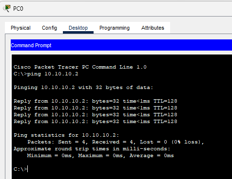
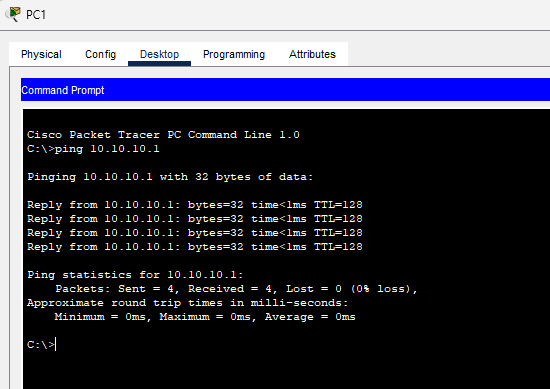
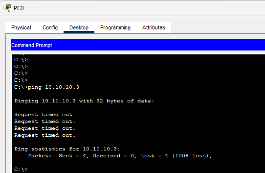
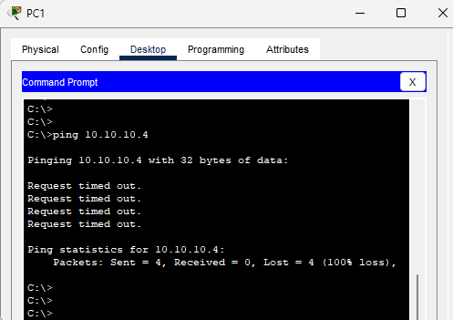
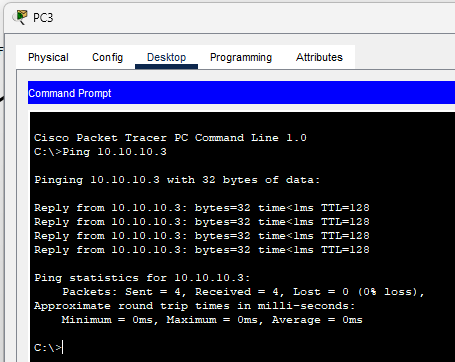
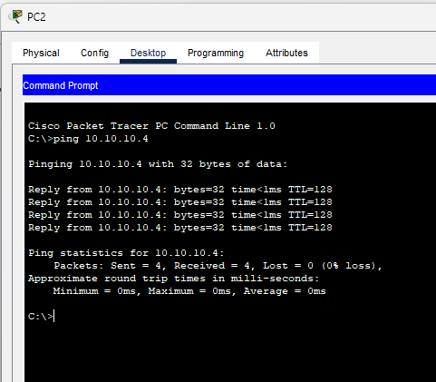
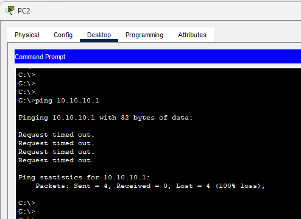

## Lab objectives

Configure VLANs on a Cisco 2960 switch. Assign ports to their respective VLANs. Connect multiple PCs using straight-through cables. Verify VLAN assignments. Test connectivity to observe communication within the same VLAN. Observe communication failure across different VLANs without inter-VLAN routing.

## Network setup overview

| Device | VLAN                  | IP Address   | Port    | Cable Type       |
| ------ | --------------------- | ------------ | ------- | ---------------- |
| PC0    | VLAN 10 (SALES)       | `10.10.10.1` | `Fa0/1` | Straight-through |
| PC1    | VLAN 10 (SALES)       | `10.10.10.2` | `Fa0/2` | Straight-through |
| PC2    | VLAN 20 (ENGINEERING) | `10.10.10.3` | `Fa0/3` | Straight-through |
| PC3    | VLAN 20 (ENGINEERING) | `10.10.10.4` | `Fa0/4` | Straight-through |

**Core device**: Cisco 2960 Switch

> **Note:** Connect all PCs directly to the switch using straight-through Ethernet cables.

## Configuration steps

1. Configure the VLANs on the switch.

   ```bash
   Switch(config)# vlan 10
   Switch(config-vlan)# name SALES
   Switch(config)# vlan 20
   Switch(config-vlan)# name Engineering
   ```

1. Assign the access ports to the VLANs.

   ```bash
   Switch(config)# interface fa0/1
   Switch(config-if)# switchport mode access
   Switch(config-if)# switchport access vlan 10

   Switch(config)# interface fa0/2
   Switch(config-if)# switchport mode access
   Switch(config-if)# switchport access vlan 10

   Switch(config)# interface range fa0/3 - 4
   Switch(config-if-range)# switchport mode access
   Switch(config-if-range)# switchport access vlan 20
   ```

1. Shut down the unused ports to secure the switch.

   ```bash
   Switch(config)# interface range fa0/5 - 24
   Switch(config-if-range)# description Inactive ports
   Switch(config-if-range)# shutdown

   Switch(config)# interface range g0/1 - 2
   Switch(config-if-range)# shutdown
   ```

## Verification commands

1. Verify the VLAN assignment on the switch.

   ```bash
   Switch# show vlan brief
   ```

   **Output**:

   ```json
   VLAN Name                             Status    Ports
   ---- -------------------------------- --------- -------------------------------
   1    default                          active    Fa0/5, Fa0/6, Fa0/7, Fa0/8
                                                   Fa0/9, Fa0/10, Fa0/11, Fa0/12
                                                   Fa0/13, Fa0/14, Fa0/15, Fa0/16
                                                   Fa0/17, Fa0/18, Fa0/19, Fa0/20
                                                   Fa0/21, Fa0/22, Fa0/23, Fa0/24
                                                   Gig0/1, Gig0/2
   10   SALES                            active    Fa0/1, Fa0/2
   20   Engineering                      active    Fa0/3, Fa0/4
   1002 fddi-default                     active
   1003 token-ring-default               active
   1004 fddinet-default                  active
   1005 trnet-default                    active
   ```

## Testing network connectivity

### Ping PC0 to PC1

1. Ping PC1 from PC0. Verify that communication succeeds because both PCs are in the Sales VLAN.

   

### Ping PC1 to PC0

1. Ping PC0 from PC1. Verify that communication succeeds because both PCs are in the Sales VLAN.

   

### Ping PC0 to PC2

1. Ping PC2 from PC0. Verify that communication fails because the PCs reside in different VLANs.

   

### Ping PC1 to PC3

1. Ping PC3 from PC1. Verify that communication fails because the PCs reside in different VLANs.

   

### Ping PC2 to PC3

1. Ping PC3 from PC2. Verify that communication succeeds because both PCs are in the Engineering VLAN.

   

### Ping PC3 to PC2

1. Ping PC2 from PC3. Verify that communication succeeds because both PCs are in the Engineering VLAN.

    

### Ping PC0 to PC2

1. Ping PC2 from PC0. Verify that communication fails because the PCs reside in different VLANs.

    

## Network ping results overview

| Source | Destination | VLANs                      | Ping Result | Explanation                                                             |
| ------ | ----------- | -------------------------- | ----------- | ----------------------------------------------------------------------- |
| PC0    | PC1         | Sales VLAN                 | Success     | Both PCs are in the Sales VLAN. Direct communication succeeds.          |
| PC0    | PC2         | Sales to HR                | Failed      | PCs are in different VLANs. Routing is not configured.                  |
| PC1    | PC3         | Sales to Engineering       | Failed      | PCs are in different VLANs. Inter-VLAN routing is not available.        |
| PC2    | PC3         | HR to Engineering          | Success     | PCs are in the Engineering VLAN. Direct communication succeeds.         |
| PC0    | PC3         | Sales to Engineering       | Failed      | PCs are in different VLANs. Routing is required for communication.      |

## Visual summary

| Ping Pair     | VLAN Connection                       | Ping Outcome |
| ------------- | ------------------------------------- | ------------ |
| PC0 - PC1     | Same VLAN (Sales VLAN)                | Success      |
| PC0 - PC2     | Different VLANs (Sales - HR)          | Failed       |
| PC1 - PC3     | Different VLANs (Sales - Engineering) | Failed       |
| PC2 - PC3     | Same VLAN (Engineering)               | Success      |

Lab files are kept in the [NetworkingLabFiles repository](https://github.com/raiz-toff/NetworkingLabFiles).
