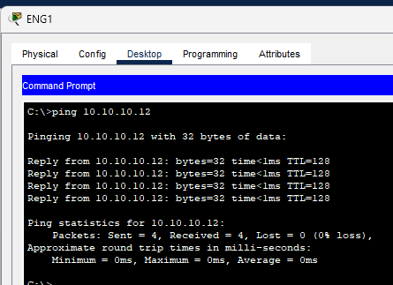
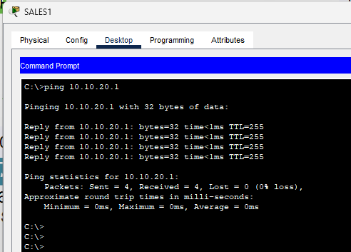
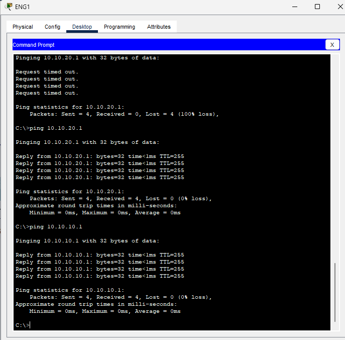
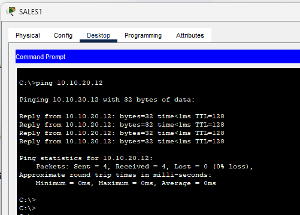
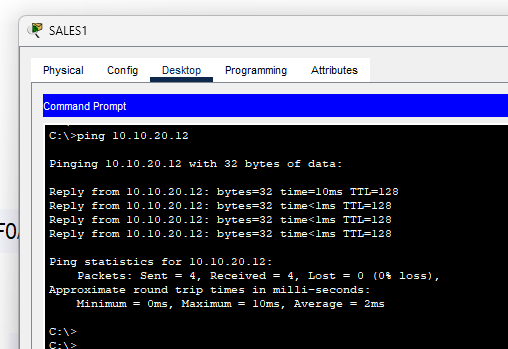
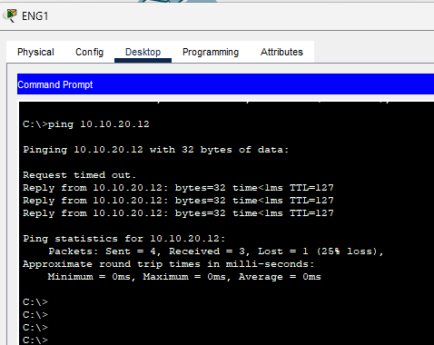
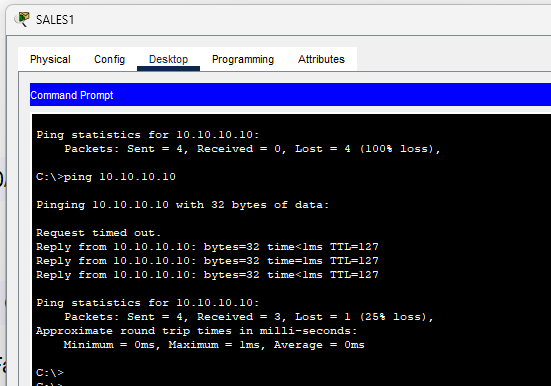

## Stage 1: Initial switch setup

1. Reset all switches and routers to the factory default state.
1. Run `show vlan brief` to verify the VLAN database. Ensure only default VLANs exist.

### Switch configuration

1. Run `show interfaces switchport` to check the default switchport settings.
1. Configure trunk links between the switches.

   ```bash
   interface Gi0/1
   switchport mode trunk
   switchport trunk native vlan 199
   ```

1. Configure VTP on the switches. Set SW1 as the server, SW2 as transparent, and SW3 as client.

   **On SW1:**

   ```bash
   vtp mode server
   vtp domain FLACKBOX
   ```

   **On SW2:**

   ```bash
   vtp mode transparent
   vtp domain FLACKBOX
   ```

   **On SW3:**

   ```bash
   vtp mode client
   vtp domain FLACKBOX
   ```

1. Create VLANs on the VTP server (SW1).

   ```bash
   vlan 10
   name ENG
   vlan 20
   name SALES
   vlan 199
   name NATIVE
   ```

1. Verify the VLAN propagation. Ensure VLANs automatically sync to SW3. Ensure SW2 remains unchanged.
1. Set the trunk native VLAN on all trunk ports for security.

   ```bash
   switchport trunk native vlan 199
   ```

1. Configure access ports for the PCs on SW3.

   ```bash
   interface range f0/1 - 2
   switchport mode access
   switchport access vlan 10
   interface f0/3
   switchport mode access
   switchport access vlan 20
   ```

1. Resolve any native VLAN mismatch errors. Match the native VLAN (199) on both sides of the trunk links. Resolve any STP blocking issues.

### Verification

1. Run `show vlan brief` to verify the VLANs.
1. Run `show interfaces trunk` to verify the trunk status.
1. Ping `Eng3` from `Eng1`. Ping `Sales3` from `Sales1`. Verify that intra-VLAN connectivity succeeds.

## Stage 2: Traditional inter-VLAN routing

Use separate physical interfaces on router R1 to route between VLANs.

### Router R1 configuration

1. Enable and assign IP addresses to the physical interfaces.

   **For ENG VLAN (`FastEthernet0/0`):**

   ```bash
   interface FastEthernet0/0
   ip address 10.10.10.1 255.255.255.0
   no shutdown
   ```

   **For Sales VLAN (`FastEthernet0/1`):**

   ```bash
   interface FastEthernet0/1
   ip address 10.10.20.1 255.255.255.0
   no shutdown
   ```

> **Note:** Ensure both interfaces are UP and functioning.

### Switch SW2 configuration

1. Verify the VLAN configuration. Ensure VLAN 10 (ENG) and VLAN 20 (Sales) exist.

   ```bash
   vlan 10
   name ENG
   vlan 20
   name Sales
   ```

1. Assign the appropriate VLANs to the access ports.

   ```bash
   interface Fa0/1
   switchport mode access
   switchport access vlan 10

   interface Fa0/2
   switchport mode access
   switchport access vlan 20
   ```

1. Configure the trunk port to the other switch.

   ```bash
   interface Gig0/1
   switchport trunk native vlan 199
   switchport mode trunk
   ```

> **Note:** Ensure VLAN interfaces `Vlan10` and `Vlan20` are UP.

### Verification steps

1. Test connectivity from `Eng1` (`Fa0/1`) to R1's VLAN 20 interface (`10.10.20.1`).
1. Test connectivity from `Eng1` to `Sales1` across the VLANs.

   
   
   
   

## Stage 3: Router-on-a-stick inter-VLAN routing

Use 802.1Q sub-interfaces on router R1 to route between VLANs.

### Router R1 configuration

1. Clear existing IP addresses from the physical interface `FastEthernet0/0`.
1. Configure sub-interfaces on `FastEthernet0/0` with 802.1Q encapsulation.

   **For VLAN 10 (ENG):**

   ```bash
   interface FastEthernet0/0.10
   encapsulation dot1Q 10
   ip address 10.10.10.1 255.255.255.0
   ```

   **For VLAN 20 (Sales):**

   ```bash
   interface FastEthernet0/0.20
   encapsulation dot1Q 20
   ip address 10.10.20.1 255.255.255.0
   ```

> **Note:** Ensure both sub-interfaces are UP. `FastEthernet0/0` now acts as an 802.1Q trunk.

### Switch SW2 configuration

1. Ensure the required VLANs exist.

   ```bash
   vlan 10
   name ENG
   vlan 20
   name Sales
   vlan 199
   name NATIVE
   ```

1. Assign the access ports.

   ```bash
   interface Fa0/1
   switchport mode access
   switchport access vlan 10

   interface Fa0/2
   switchport mode access
   switchport access vlan 20
   ```

1. Configure the `Fa0/1` interface (connected to R1) as an 802.1Q trunk.

   ```bash
   interface Fa0/1
   switchport trunk encapsulation dot1q
   switchport mode trunk
   switchport trunk allowed vlan 10,20
   ```

> **Note:** Ensure the trunk is operational and forwarding VLAN 10 and 20 traffic.

1. Set the default gateway on SW2.

   ```bash
   ip default-gateway 10.10.10.1
   ```

### Verification steps

1. Ping `10.10.20.1` from `Eng1` (VLAN 10).
1. Ping `Sales1` from `Eng1`.

   

1. Ping `Sales3` from `Eng1`.

   

1. Ping `Eng1` from `Sales1`.

   

## Conclusion

This lab implemented VLAN segmentation with VTP across multiple switches. It configured inter-VLAN routing using separate physical interfaces. It implemented Router-on-a-Stick using sub-interfaces. It resolved native VLAN mismatches and verified connectivity across all VLANs.
