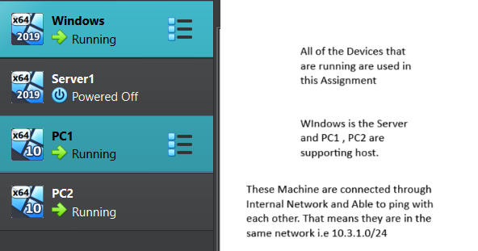
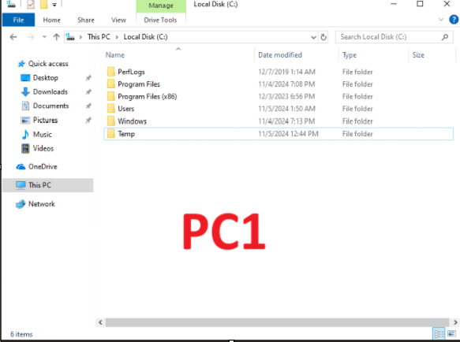
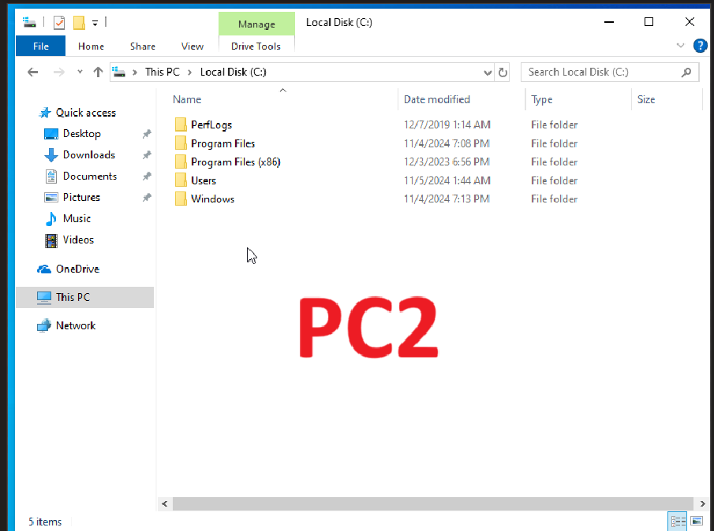
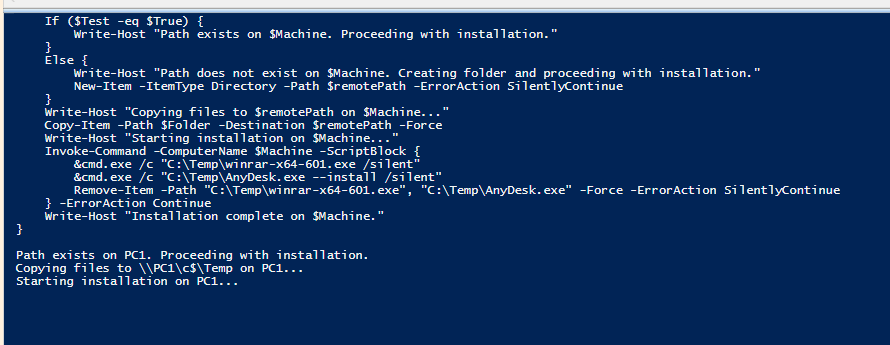
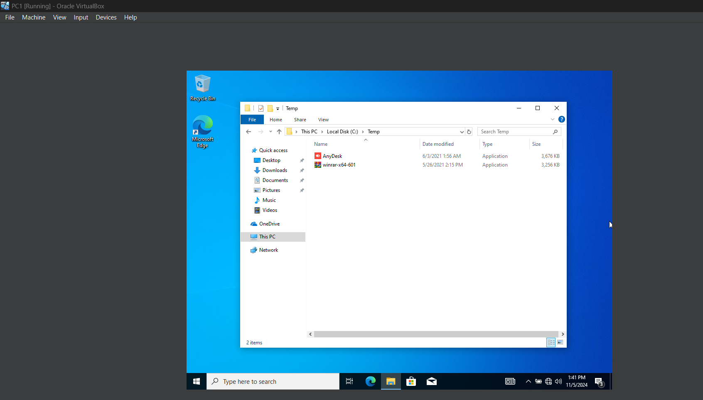
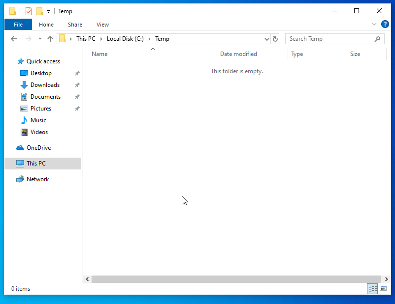
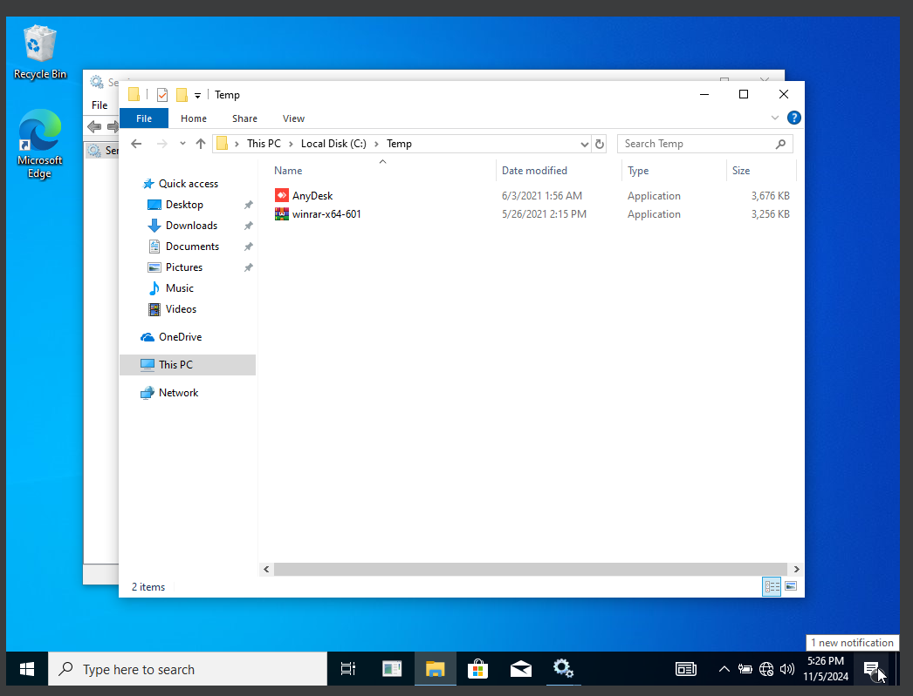
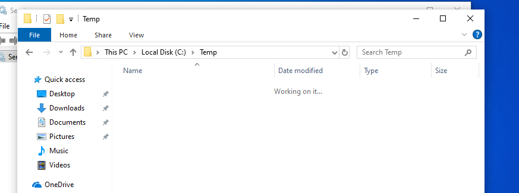

## Lab objectives

Configure a centralized software deployment system in Active Directory. Deploy applications from the Domain Controller to member workstations. Use PowerShell remoting and silent installers to automate deployment.



## Automated deployment script

1. Review the installation script. The script copies binaries to the target `C:\Temp` directory and executes them silently.

```powershell
$HostsList = Get-Content "C:\Remote Install\livepc.txt"
$Folder = "C:\Remote Install\winrar-x64-601.exe", "C:\Remote Install\AnyDesk.exe"

foreach ($Machine in $HostsList) {
    $remotePath = "\\$Machine\c$\Temp"
    $Test = Test-Path -Path $remotePath

    if ($Test -eq $true) {
        Write-Host "Path exists on $Machine. Proceeding with installation."
    } else {
        Write-Host "Path does not exist on $Machine. Creating folder..."
        New-Item -ItemType Directory -Path $remotePath -ErrorAction SilentlyContinue
    }

    Write-Host "Copying files to $remotePath on $Machine..."
    Copy-Item -Path $Folder -Destination $remotePath -Force

    Write-Host "Starting installation on $Machine..."
    Invoke-Command -ComputerName $Machine -ScriptBlock {
        &cmd.exe /c "C:\Temp\winrar-x64-601.exe /silent"
        &cmd.exe /c "C:\Temp\AnyDesk.exe --install /silent" 
        Remove-Item -Path "C:\Temp\winrar-x64-601.exe", "C:\Temp\AnyDesk.exe" -Force -ErrorAction SilentlyContinue
    } -ErrorAction Continue

    Write-Host "Installation complete on $Machine."
}
```

## Deployment steps

1. Check the initial state of the target workstations. Verify the existence of the `C:\Temp` directory.

   
   

1. Enable Windows Remote Management (WinRM) on all target workstations. Execute the command in an elevated PowerShell session.

   ```powershell
   Enable-PSRemoting -Force
   ```

   
   

1. Execute the deployment script from the Domain Controller. Verify the console output for each target workstation.

   
   

1. Log in to the target workstations. Open the **Control Panel**.
1. Verify the applications appear in the installed programs list.

   
