## Lab objectives

Install the DHCP Server role on Windows Server. Configure a DHCP IP address scope and exclusion ranges. Verify dynamic IP leasing on a Windows 10 client.

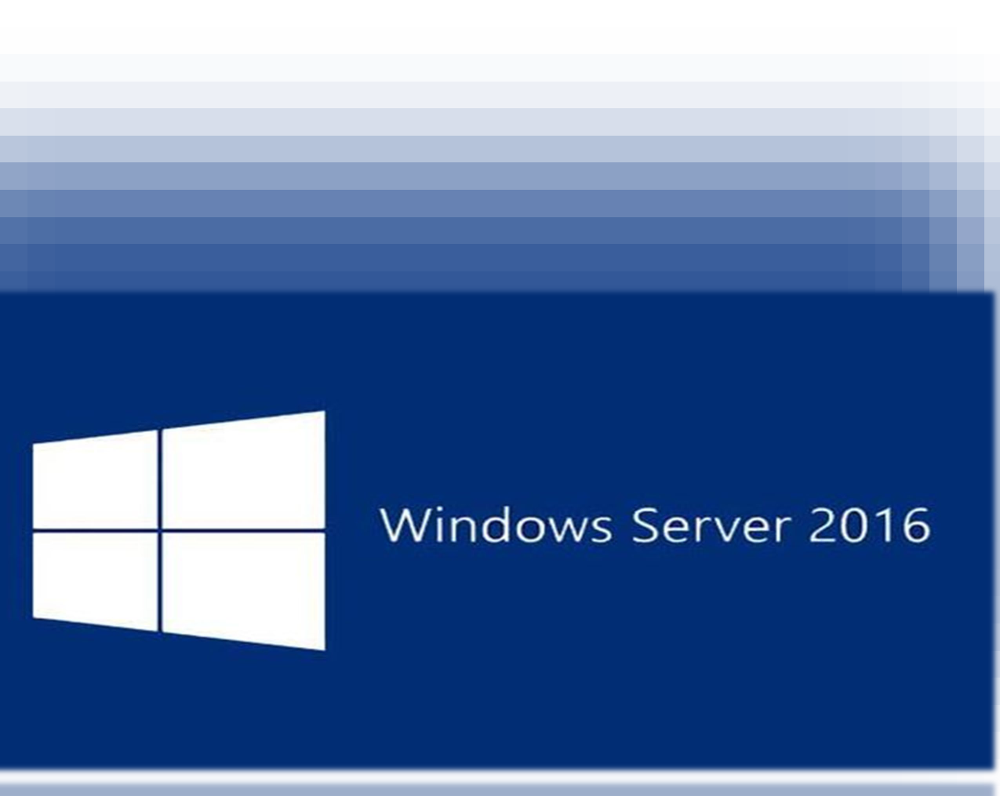

## Phase 1 DHCP server role installation

1. Open the **Add Roles and Features Wizard** from **Server Manager**.
2. Navigate to the **Server Roles** tab. Check the box for **DHCP Server**.

   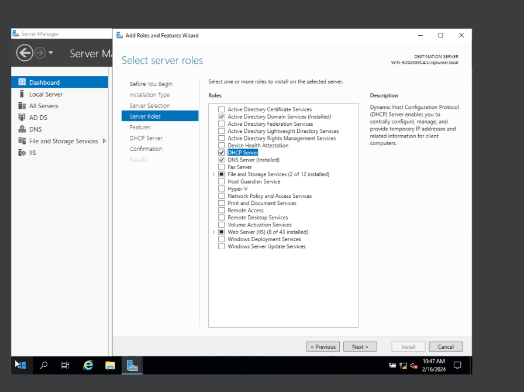

3. Review the selected options in the confirmation tab. Check **Restart the destination server automatically if required**.
4. Click **Install**.

   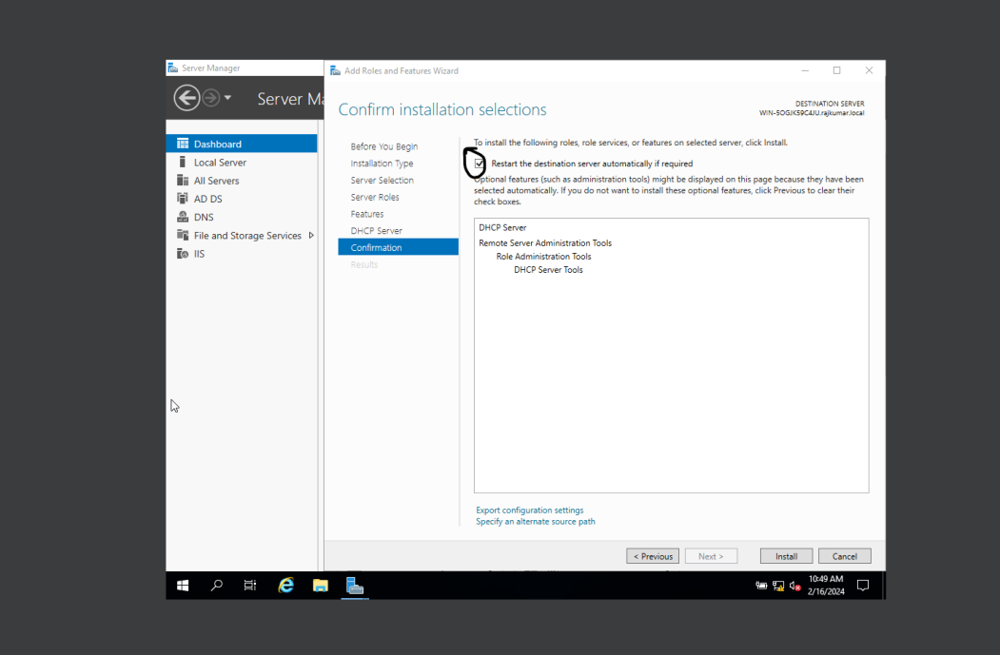

5. Wait for the installation to finish.

   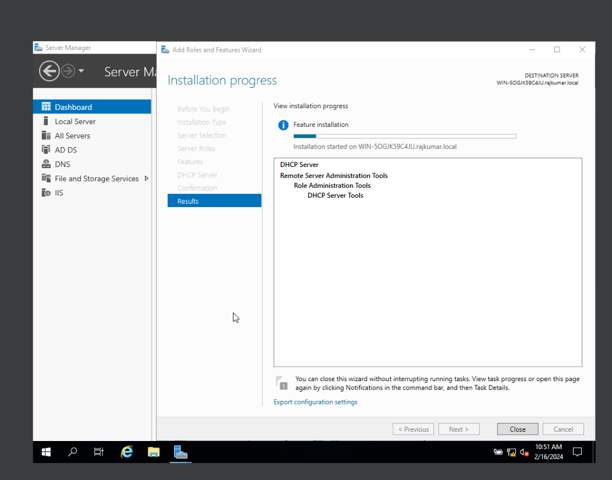

6. Click **Close** when the installation completes.
7. Click the warning flag in **Server Manager**. Select **Complete DHCP Configuration**.

   

8. Authorize the DHCP server using Domain Administrator credentials in the Post-Install Wizard.
9. Review the security groups summary. Click **Close**.

   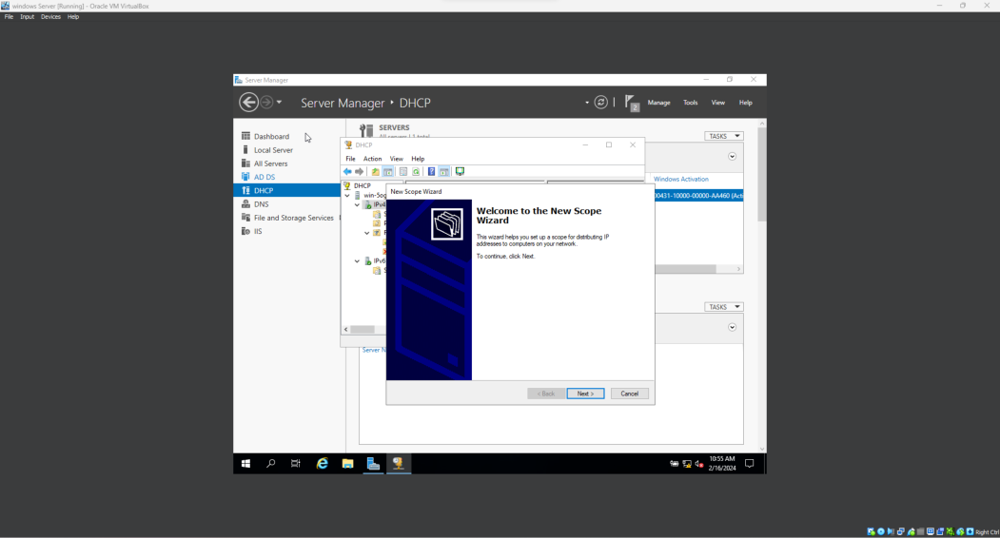

## Phase 2 DHCP scope configuration

1. Open the **DHCP console**.
1. Expand the IPv4 node. Right-click the node and select **New Scope**.
1. Provide a descriptive name for the scope.

    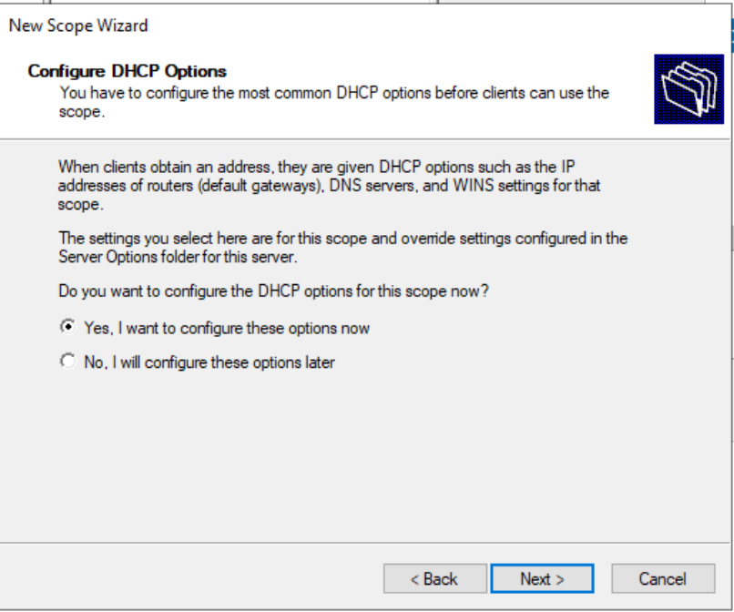

1. Enter the IP Address Range. Specify `192.168.10.20` to `192.168.10.100`. Specify subnet mask `255.255.255.0`.

    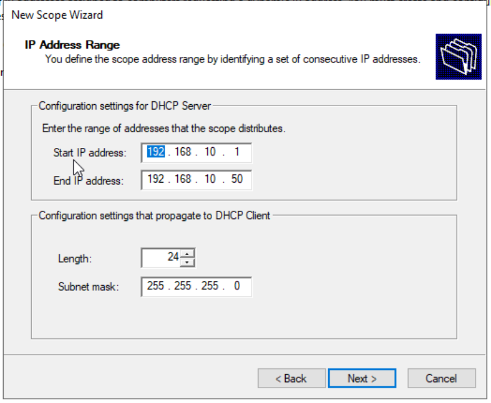

1. Specify any IP addresses within the pool to exclude. Enter the exclusion range and click **Add**.

    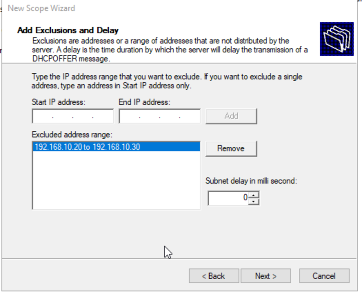

1. Set the lease duration to 8 days.

    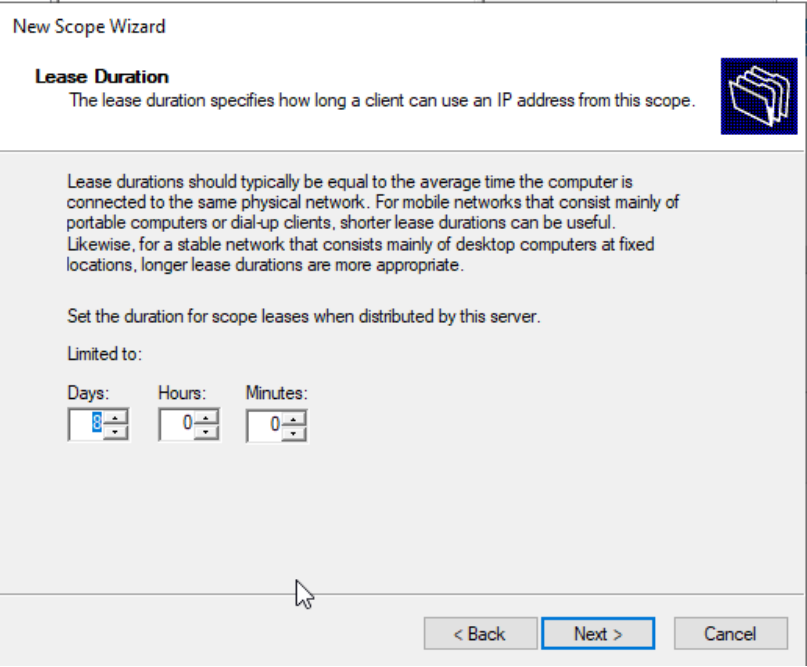

1. Select **Yes, I want to configure these options now** under **Configure DHCP Options**.
1. Enter the local gateway IP address on the Router page. Click **Add**.

    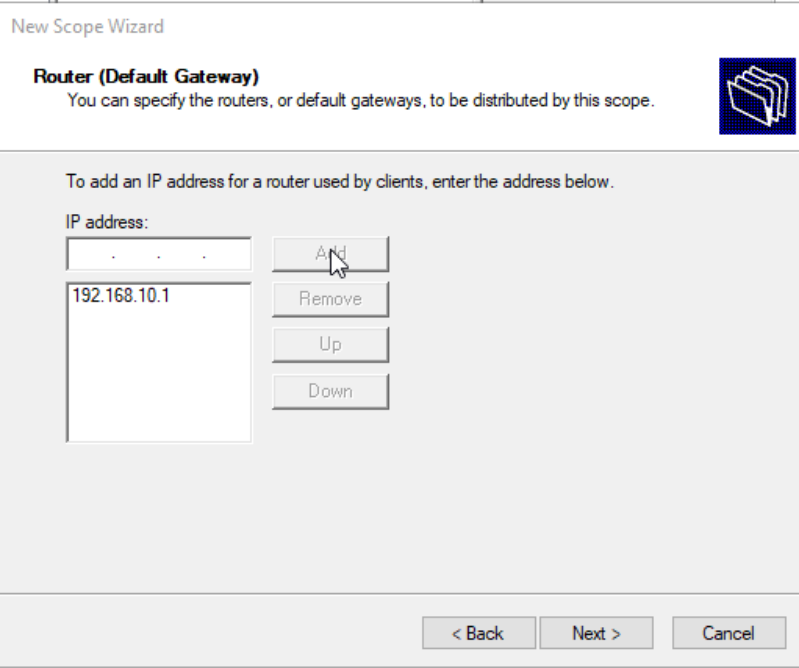

1. Enter the parent domain name. Provide the primary DNS server IP addresses.

    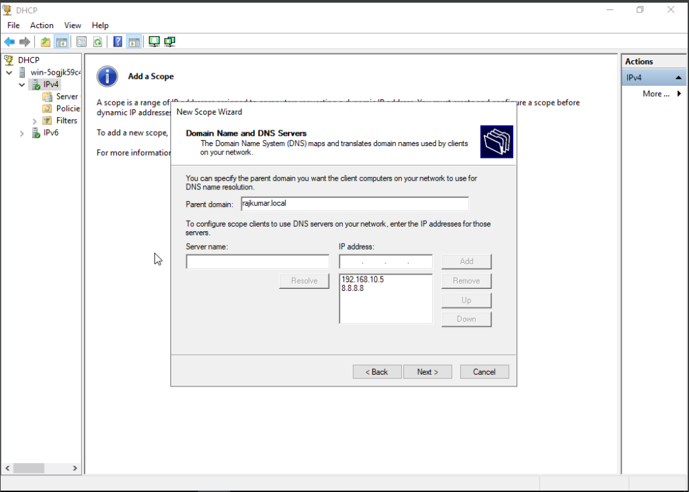
    

1. Select **Yes, I want to activate this scope now** on the final page.
1. Click **Finish**.

    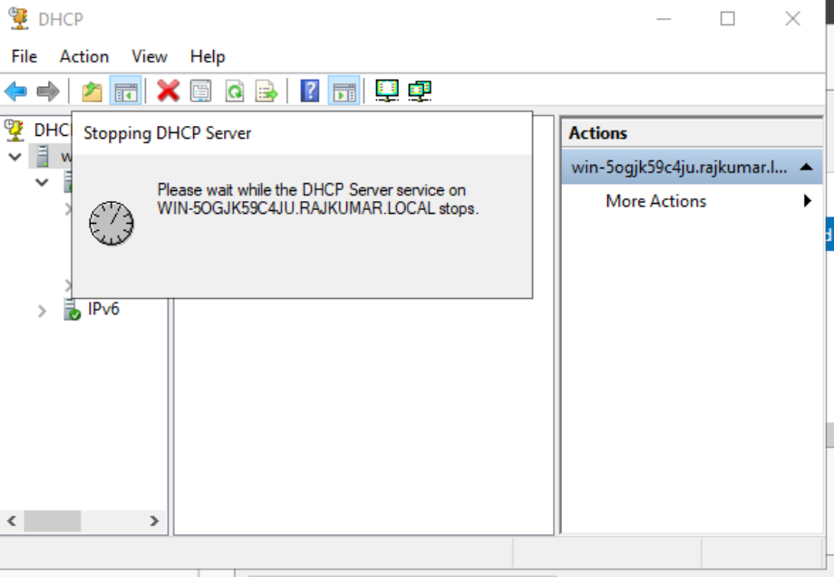

## Phase 3 Client DHCP verification

1. Check the initial client network settings. Run `ipconfig /all`.

    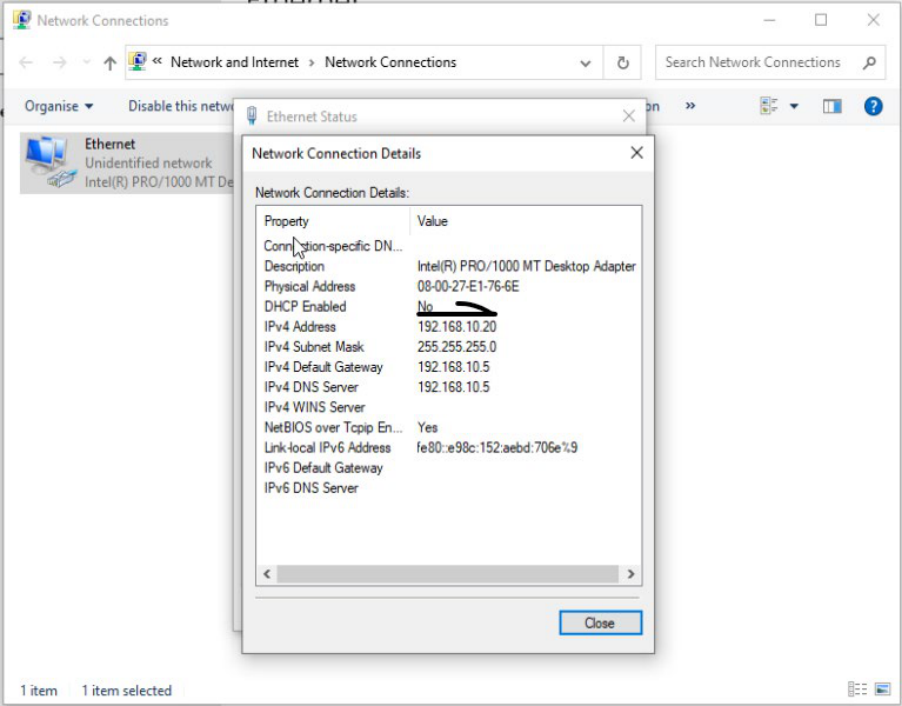

1. Modify the Ethernet adapter properties on the Windows 10 host.
1. Select **Obtain an IP address automatically** and **Obtain DNS server address automatically**.
1. Click **OK**.

    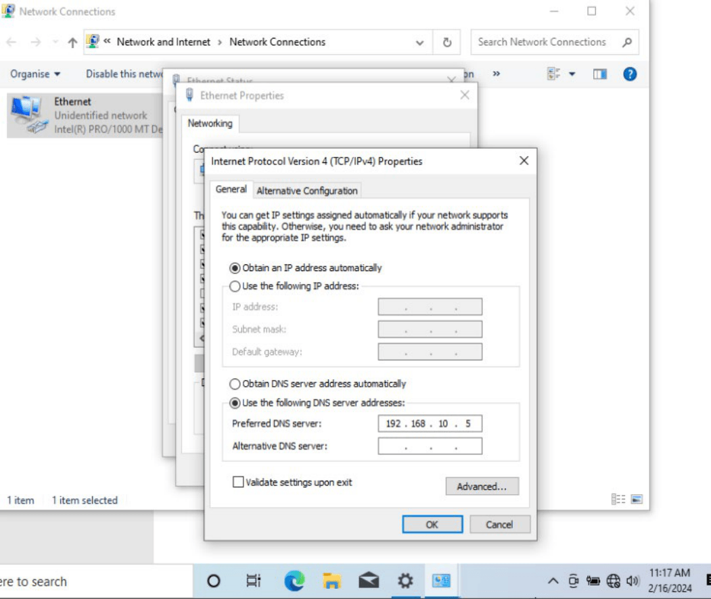

1. Open the Command Prompt on the client host.
1. Run `ipconfig /renew`. Verify the successful IP lease and network settings.

    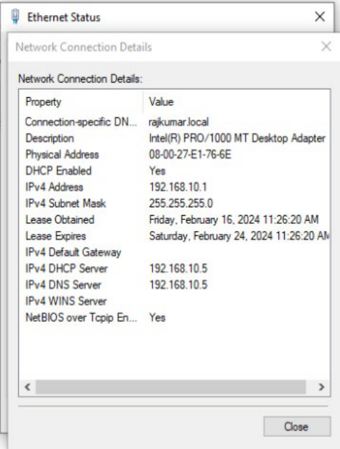
