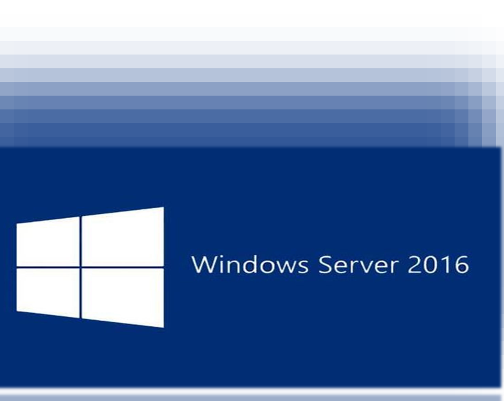
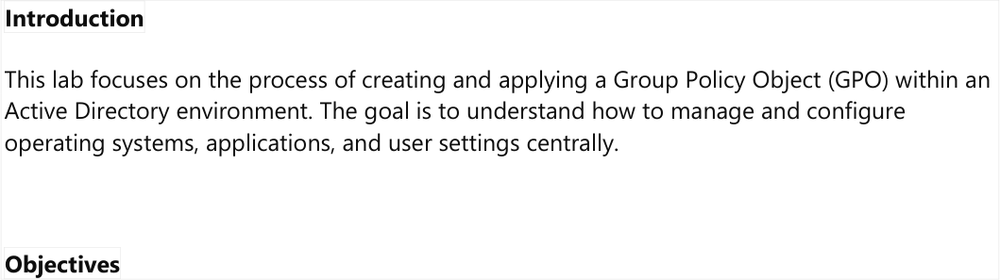
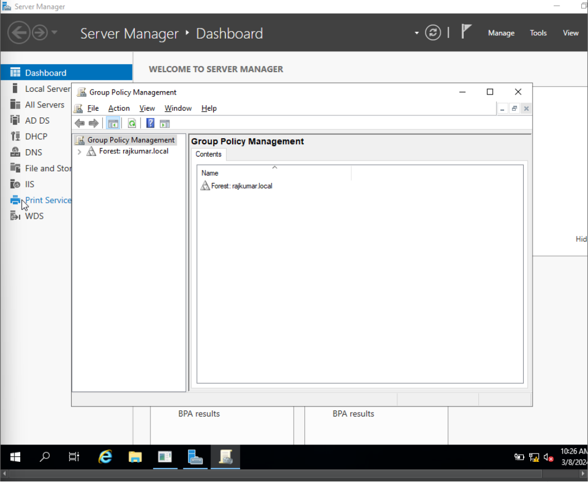
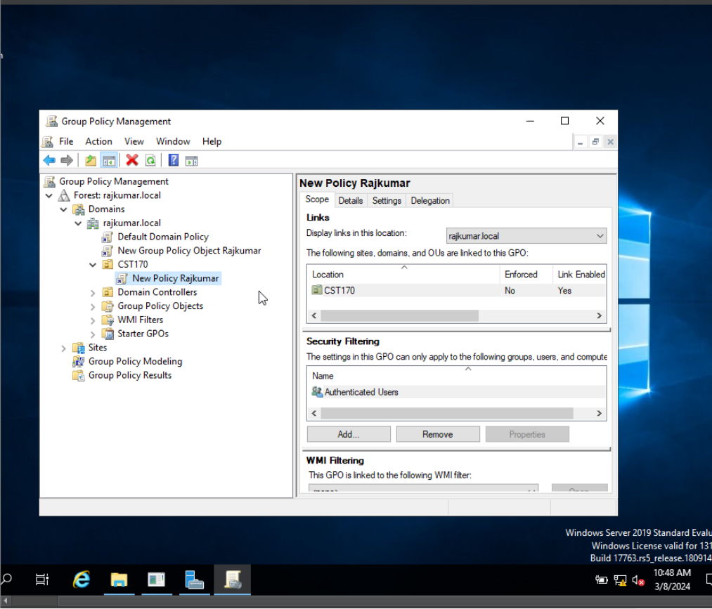
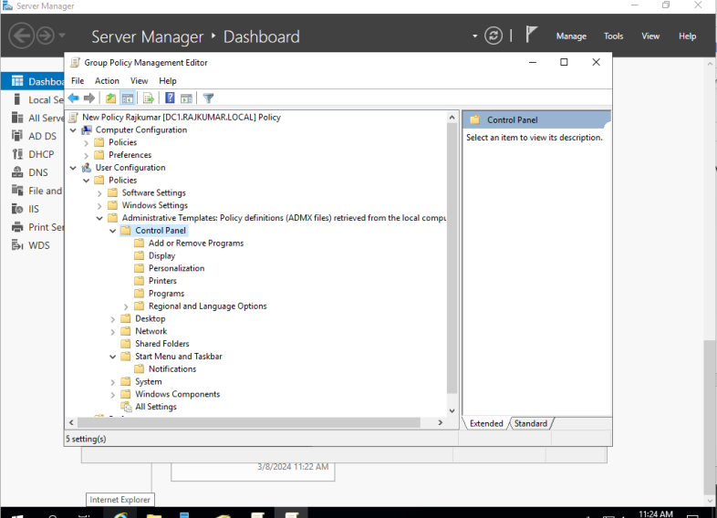
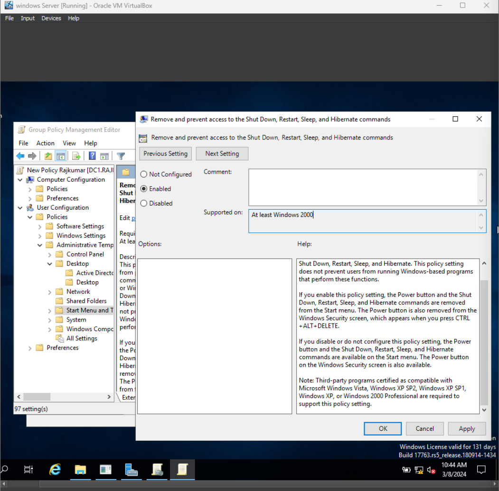
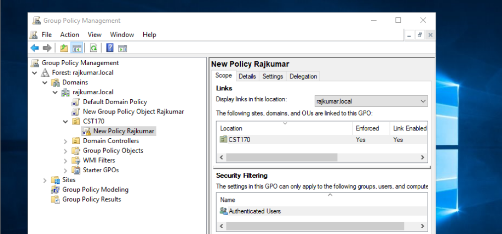
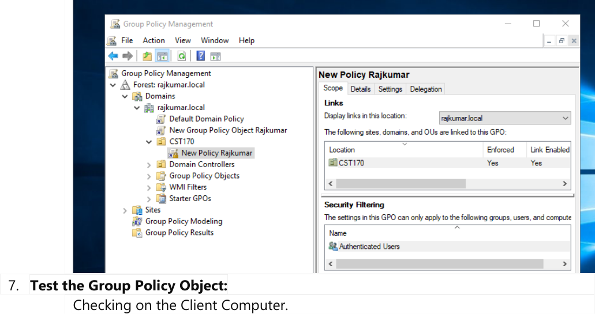
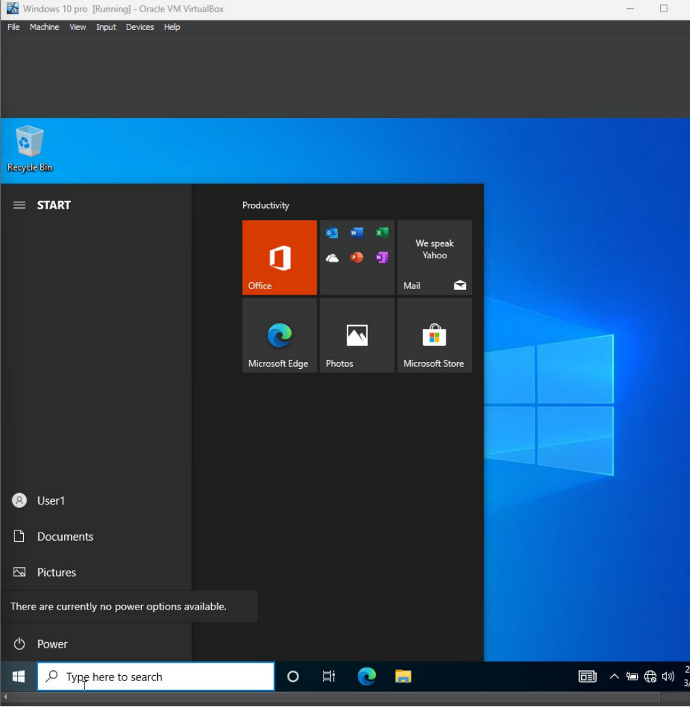

## Phase 1 GPO creation and linking

1. Log in to the Domain Controller.
2. Open **Server Manager**. Click **Tools** and select **Group Policy Management**.

   

3. Expand the console tree. Navigate to **Forest: rajkumar.local > Domains > rajkumar.local**.
4. Locate the `CST170` Organizational Unit.

   

5. Right-click the **CST170** OU. Select **Create a GPO in this domain, and Link it here...**.
6. Enter `New Policy Rajkumar` as the GPO name. Click **OK**.

   

## Phase 2 Policy settings configuration

1. Right-click the newly created GPO under the `CST170` OU. Select **Edit**.

   

1. Navigate to the Start Menu administrative templates path. Select **User Configuration > Policies > Administrative Templates > Start Menu and Taskbar**.
1. Locate the **Remove and prevent access to the Shut Down, Restart, Sleep, and Hibernate commands** setting.
1. Double-click the setting. Change the value to **Enabled**. Click **OK**.

    

## Phase 3 Enforcing and testing the policy

1. Return to the Group Policy Management Console.
1. Verify the GPO link status shows **Link Enabled** on the `CST170` OU.
1. Right-click the link and select **Enforced**.

    
    

1. Log in to the Windows 10 client host. Use a domain user account from the `CST170` OU.
1. Open the Command Prompt. Run the `gpupdate /force` command.
1. Open the **Start Menu**. Click the **Power** icon.
1. Verify the power options are removed and the restriction message appears.

    
