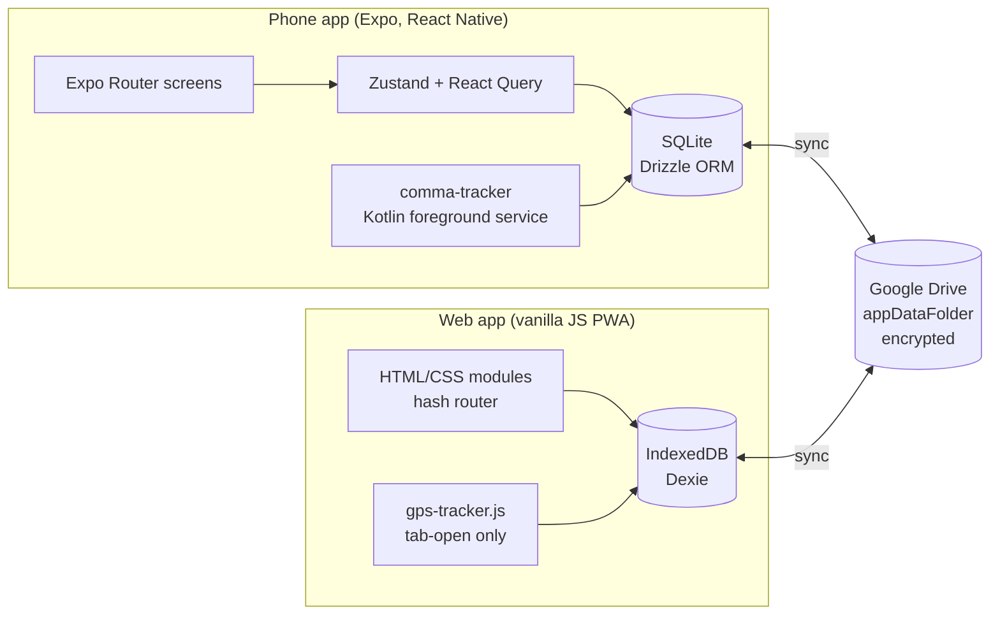

Comma is a local-first monorepo. The database on each device is the source of truth for that device. Comma runs no servers and has no user accounts.

## Design principles

1. **Local-first.** No core feature requires a network.
2. **No backend, no account.** The only external service is the driver's own Google Drive, and only on opt-in.
3. **Two apps, one model.** Both apps implement the same concepts: shifts, expenses, vehicles and tax.
4. **Pluggable registries.** Countries and platforms are data. Adding one is a registry file per app, registered in one place.
5. **Native where required.** Background GPS on Android needs a foreground service, so tracking is a Kotlin module.

## The two applications

| | Phone app | Web app |
|---|---|---|
| Location | Repository root, `modules/comma-tracker/` | `web/` |
| Framework | Expo and React Native, TypeScript | Vanilla JavaScript, no framework |
| UI | React Native, NativeWind | Hand-written HTML and CSS modules |
| Routing | Expo Router (file-based) | Hash router |
| Storage | SQLite through Drizzle ORM | IndexedDB through Dexie |
| State | Zustand and TanStack React Query | Module singletons |
| GPS | Native foreground service | `navigator.geolocation.watchPosition`, tab-open only |
| Offline shell | Native app | Service worker |

## Data split

Synced data is divided into three buckets.

| Bucket | Synced | Examples |
|---|---|---|
| Device-local | No | Raw location points, temporary native points |
| Synced records | Yes | Shifts, expenses, vehicles, goals, merchants |
| Profile | Yes | Country, platforms, preferences |

The bulky location tables are excluded from sync. Only the simplified route is stored with a shift.

## Encryption

| Property | Value |
|---|---|
| Cipher | AES-256-GCM |
| Key derivation | PBKDF2, 210,000 iterations |
| Salt and IV | Random, per file |
| Key storage | The key is never written or uploaded |

Release 1.4.2 removed the unencrypted sync mode. Connecting Google Drive requires a backup password before any file is uploaded.

## Known structural costs

- The two apps use different storage engines and grew different column names and value types.
- The sync protocol is implemented twice, in TypeScript and in JavaScript, and both must stay wire-compatible.
- The web app cannot record GPS in the background.

The effects are described in [Sync engine](/docs/projects/comma/sync-engine) and [GPS tracking](/docs/projects/comma/gps-tracking).
