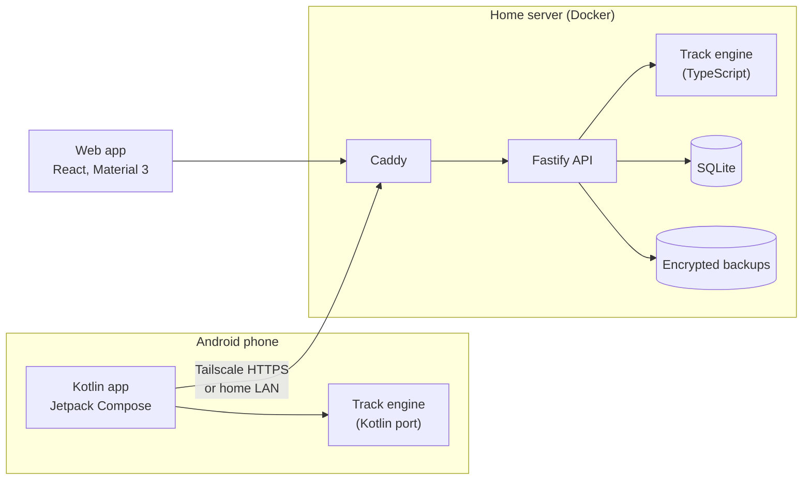

MileWage has three applications and one shared engine. The server is the single source of truth. The phone is a recorder that can work offline and send later.

## Components

| Component | Location | Stack | Role |
|---|---|---|---|
| Server | `apps/server` | Fastify, SQLite (`better-sqlite3`), Docker, Caddy | Stores the data, recomputes every shift, makes the backups. |
| Web app | `apps/web` | React, restyled to Material Design 3 | Dashboard, shifts, expenses, tax, exports, backups, devices, settings. |
| Android app | `apps/android` | Kotlin, Jetpack Compose, Material 3 | Records GPS during a shift and sends it when the server is reachable. |
| Track engine | `packages/track-engine` | TypeScript, no dependencies, no I/O | Turns GPS fixes into distances, trips and stops. |
| Shared contract | `packages/shared` | OpenAPI | The API contract and the types generated from it. |

The container limits are 192 MB for the API and 64 MB for Caddy.

## Android modules

The Android app has five Gradle modules.

| Module | Platform imports | Contents |
|---|---|---|
| `:engine` | None | Kotlin port of `packages/track-engine` |
| `:core` | None | Models, formats, pairing, sending and tracking decisions |
| `:data` | Android | Room, OkHttp, Keystore, WorkManager |
| `:tracking` | Android | Location service, receivers, notifications |
| `:app` | Android | Compose screens |

`:engine` and `:core` contain no `android.*`, `androidx.*`, `java.*` or `javax.*` imports. A `ModuleRulesTest` in each module fails the build otherwise. The restriction keeps both modules portable to Kotlin Multiplatform for a later iPhone app.

## Life of a shift

1. The driver starts a shift in the Android app. A foreground service requests a GNSS fix every 5 seconds.
2. The app stores every fix in a local database. No network connection is required.
3. When the shift ends, the Kotlin engine computes the total and the app shows it.
4. The app sends the raw fixes when the server is reachable.
5. The server runs the TypeScript engine on the fixes it received.
6. Matching totals mark the shift as matching. Different totals flag the shift and show the difference. Neither value is overwritten.
7. The server writes an encrypted backup after the shift ends.

## Constraints

- **One driver per server.** There are no multi-tenant accounts.
- **No inbound ports.** The phone reaches the server through `tailscale serve`, or through plain HTTP on private addresses only.
- **No Google Play Services.** The build task `check<Variant>Policy` fails if a `com.google.android.gms`, `com.google.firebase`, `com.google.mlkit` or `com.google.android.play` artifact reaches the runtime classpath.
- **No silent recalculation.** A finalized shift is never recomputed. After an engine upgrade, `milewage-cli recalc --dry-run` lists the shifts whose totals would change.
- **Hand-written request models.** `ContractDriftTest` in `:core` checks the Kotlin models field by field against `openapi.yaml`.

## Backups

The server makes a backup at 03:30 local time, after each shift, before a migration and before a restore. Each backup is verified after it is written, and a backup that fails verification is discarded.

Retention keeps the newest backup of the last 7 days, 4 Sundays and 12 first days of the month. A backup is skipped when free disk space is below twice the database size.

## Verification status

Tests run on a computer only: unit tests, Robolectric screen renders and the engine cross-check against Node on x86-64. The following items are unverified:

- The Android app on a physical phone.
- The engine's arithmetic on arm64, on both a phone and a Raspberry Pi.
- A shift recorded over a real Tailscale network.
